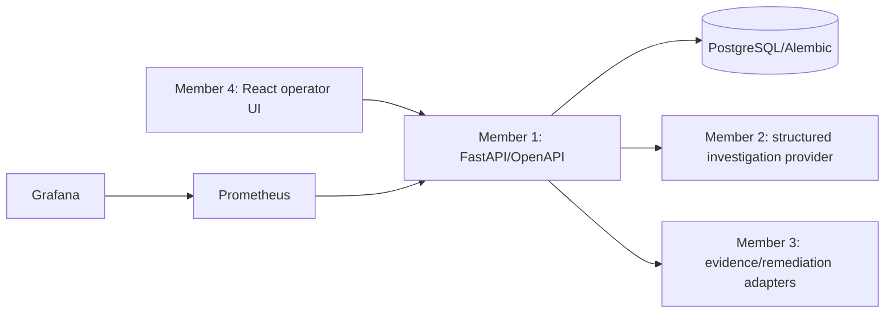

# FixProof Delivery Plan

## Mission and scope

FixProof is a local-first AI-assisted cloud operations product. It must explain evidence-backed likely causes of incidents, propose safe remediation, require human approval, execute only controlled allowlisted changes, independently verify recovery, and preserve an auditable history. Its Cloud Cost Autopsy must calculate cost drivers from source billing records and distinguish measured cost from estimated savings.

The MVP runs locally with synthetic evidence, billing data, a deterministic mock AI provider, PostgreSQL, Docker Compose, Prometheus, and Grafana. It does not require AWS credentials or an external LLM API.

## Guiding decisions

- Modular monolith: FastAPI owns API and domain rules; React owns the operator experience; PostgreSQL owns durable state.
- OpenAPI is the shared contract. TypeScript types are generated from it before the UI grows beyond the initial scaffold.
- AI is advisory and bounded. Tools are separated into read-only evidence collection and controlled mutation services.
- An approval binds to one immutable recommendation version. Any content/target/parameter change creates a new version and invalidates prior approval.
- Execution and verification are separate outcomes. Neither the UI nor AI may fabricate success.
- Infrastructure adapters default to local deterministic implementations; cloud and Kubernetes adapters arrive only after safety controls and tests.

## Architecture workstreams

## Team allocation

| Member | Primary ownership | Must coordinate with |
|---|---|---|
| Member 1 | API routes, schemas, domain services, SQLAlchemy, Alembic, approval/execution/audit enforcement, backend tests | Members 2 and 4 on contracts; Member 3 on adapters |
| Member 2 | Provider interface, mock and external model providers, evidence normalization, hypotheses, structured proposals, cost narratives, agent tests | Member 1 on validated schemas; Member 3 on evidence boundaries |
| Member 3 | Docker/Compose, monitoring, sample workload, metrics/log adapters, isolated remediation environment, later Kind | Member 1 on readiness/actions; Member 4 on integration health UX |
| Member 4 | React UI, generated client types, dashboard, incidents, approvals, cost/autopsy, audit UX, component/E2E tests | Member 1 on OpenAPI compatibility |

## Phase plan

### Phase 0 — Assessment and architecture — DONE

Objective: establish the source-of-truth repository state and make reversible architectural decisions.

- Deliverables: initial assessment, architecture, API/database documentation, security rules, ownership matrix, this plan.
- Acceptance: repository and Git state inspected; no existing work overwritten; ownership and system boundaries explicit.
- Risks: hidden local credentials or user work. Mitigation: never stage ignored files or reset the worktree.

### Phase 1 — Runnable scaffold and Docker — IN PROGRESS

Objective: make one developer command start the local development foundation.

- Member 3: finish Compose health validation, Grafana dashboard provisioning, graceful service shutdown, sample workload profile.
- Member 1: complete readiness dependency checks and migration validation.
- Member 4: add loading/error states and API connectivity indicator.
- Deliverables: Dockerfiles, Compose, `.env.example`, Make targets, health endpoints, Prometheus/Grafana configuration, CI builds.
- Acceptance: `make up`, `make migrate`, `make seed`, and `make down` work on a clean machine; web/API/Prometheus/Grafana are reachable; DB data survives `make clean`.
- Tests: Compose config, image builds, startup/readiness smoke test, migration run.
- Risks: host Docker/registry permissions. Mitigation: document prerequisites and keep all build steps containerized.

### Phase 2 — Database and APIs — IN PROGRESS

Objective: represent the full operational lifecycle with durable, constrained state.

- Member 1: add investigations, evidence items, approvals, executions, verification results, cost analyses, and cost records.
- Add migrations with indexes, foreign keys, check constraints, UUIDs, append-only audit events, pagination, idempotency keys, and consistent errors.
- Implement remaining API endpoints: execution, verification, individual analysis read, and integration status.
- Acceptance: documented OpenAPI matches routes; migrations upgrade/downgrade in isolated DB; invalid state transitions return 409; all critical records are auditable.
- Tests: API, database integration, migration, pagination, idempotency, authorization boundary tests.
- Dependency: Phase 1 database and health foundation.

### Phase 3 — Frontend and deterministic workflow — IN PROGRESS

Objective: deliver an operational console rather than a chatbot.

- Member 4: build Overview, Incidents, Incident Details, Evidence, Timeline, Remediation Review, Approval, Execution/Verification, Cost Autopsy, Audit, and Integration Status pages.
- Generate API client types from `/openapi.json`; add reusable tables, status badges, error/empty/loading states, responsive layout, and accessible controls.
- Acceptance: every UI state comes from an API record; evidence and AI interpretation are visibly separate; no fake execution success.
- Tests: strict TypeScript, React Testing Library flows, essential Playwright approval flow.
- Dependency: Phase 2 endpoint contracts.

### Phase 4 — Observability and evidence collection — NOT STARTED

Objective: introduce a reproducible incident with bounded, attributable evidence.

- Member 3: create a sample workload and controlled error-rate/latency scenario; expose Prometheus metrics and bounded logs; document reset steps.
- Member 1: store normalized evidence snapshots with source, timestamp, hash, and trust label.
- Acceptance: an alert leads to retained metrics, logs, deployment history, and event evidence; reset returns the scenario to baseline.
- Tests: metric assertions, evidence normalization tests, no unbounded log ingestion.
- Risks: malicious/instruction-like log content. Mitigation: label all artifacts as untrusted data.

### Phase 5 — AI-assisted investigation — NOT STARTED

Objective: offer useful but constrained investigation support.

- Member 2: define a provider protocol; implement deterministic mock and configuration-based NVIDIA/Nebius-compatible provider.
- Implement explicit workflow: gather → normalize → hypothesize → explain support/contradiction → identify gaps → propose → schema validate.
- Use LangGraph only if its state graph adds value over a testable service workflow.
- Acceptance: mock provider works without keys and labels output; invalid external output fails safely; every claim references retained evidence.
- Tests: invalid JSON, schema mismatch, missing evidence, prompt injection text, provider timeout/fallback.
- Dependency: normalized evidence schema from Phase 4.

### Phase 6 — Safe remediation and verification — NOT STARTED

Objective: make the mutation path backend-enforced and demonstrably safe.

- Member 1: immutable proposal hashing/versioning, approval expiry, actor identity, idempotency, execution records, verification records.
- Member 3: local allowlisted action adapter and isolated test environment; later controlled Kind action adapter.
- Member 2: proposal validator limited to supported action schemas.
- Acceptance: only approved, current, unexpired, allowlisted recommendations execute once against their exact target; verification independently measures recovery.
- Tests: no approval, expired/rejected/modified proposal, duplicate request, failed execution, failed verification, target mismatch.
- Risks: accidental live mutation. Mitigation: default read-only policy and local-only adapter until explicit production controls exist.

### Phase 7 — Cloud Cost Autopsy — IN PROGRESS

Objective: make cost explanations calculable and transparent.

- Member 2: maintain synthetic billing fixtures and calculations for totals, period changes, drivers, zero baseline, missing data, and estimated savings assumptions.
- Member 4: build breakdown and trend visualizations with explicit measured-versus-estimated labels.
- Member 1: persist analyses and source cost records.
- Acceptance: every figure derives from source rows; recommendations state assumptions and potential-savings formula; no prose-derived billing totals.
- Tests: numerical edge cases, incomparable periods, tag/resource grouping, serialization.

### Phase 8 — Kubernetes, security, and final demonstration — NOT STARTED

Objective: prove the system safely end to end.

- Member 3: Kind cluster lifecycle and controlled remediation adapter.
- Member 1: authentication/authorization hardening and audit retention policies.
- Member 4: Playwright demo flow and accessibility pass.
- All members: CI hardening, secret/dependency scans, final demo rehearsal.
- Acceptance: documented clean-machine demonstration produces an incident, evidence, bounded proposal, approval, controlled action, recovery verification, incident report, and cost autopsy.

## Integration checkpoints

1. **Contracts checkpoint:** Member 1 publishes OpenAPI; Member 4 generates types and runs compatibility tests.
2. **Evidence checkpoint:** Members 2 and 3 agree on normalized evidence shape, provenance, size bounds, and trust labels.
3. **Safety checkpoint:** Members 1–3 review action schemas, target identity, expiry, and verification independently of UI.
4. **Demo checkpoint:** all workstreams run the same Compose profile and demo runbook from a clean state.

## Pull-request policy

- Keep changes within owned modules unless a cross-module contract change is necessary.
- Every PR includes tests and updates relevant docs/runbooks.
- API/OpenAPI changes require Member 1 and Member 4 review.
- Docker/Compose/Kind changes require Member 3 review.
- AI prompt/workflow changes require Member 2 plus Member 1 review.
- Migration and remediation changes require explicit rollback/safety notes.
- Never merge secrets, generated local data, or an unverified claim of live infrastructure action.

## Definition of done

A phase is DONE only when its acceptance criteria are reproducibly verified, CI is green, documentation reflects the final decision, no required security control is merely a UI warning, and the responsible member demonstrates the result at the corresponding integration checkpoint.
