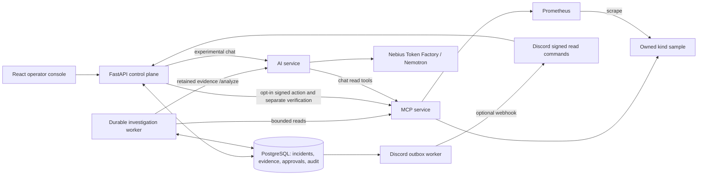

# FixProof

FixProof is a local-first, evidence-grounded DevOps assistant that helps an operator investigate a Kubernetes incident, review one exact restoration proposal, and independently decide whether recovery occurred.

The demonstration incident is deliberately narrow: a configuration change makes the owned `sample-api` return HTTP 500 while its readiness endpoint remains healthy. FixProof collects bounded Kubernetes and Prometheus observations, retains and cites them, asks a configured NVIDIA Nemotron model for evidence-grounded hypotheses, then keeps approval and execution under deterministic controls.

## Demo links

- Working demo or accessible test build: **[to be added before submission]**
- Public YouTube demonstration (three minutes or less): **[to be added before submission]**

These are intentionally marked as pending rather than linking to an unverified deployment or video.

See [the submission handoff](SUBMISSION_HANDOFF.md) for the remaining external assets, source checks, and implementation boundary.

## How it works

1. An authenticated operator reports the incident.
2. A durable worker gathers bounded Kubernetes, Prometheus, log, event, and probe evidence.
3. The AI service stores the evidence and asks the configured Nemotron model for cited hypotheses, contradictions, gaps, and uncertainty.
4. FixProof creates an exact, versioned restoration proposal; a human must approve it before any write can be considered.
5. The scoped writer applies guarded preconditions, then independent rollout, probe, and fresh-traffic checks determine recovery. A successful patch alone is not a recovery verdict.

## Implementation status

| Capability | Current status |
|---|---|
| Incident investigation | Authenticated intake, durable collection jobs, five bounded evidence sources, retained findings and strict analysis citations are implemented; earlier local investigation/restart acceptance is recorded. |
| Exact proposal and restore | Version/hash/expiry review, human approval, scoped capabilities, atomic Kubernetes preconditions and replay protection are implemented. One controlled live restore passed earlier local acceptance. Writes are disabled by default. |
| Independent verification | Rollout checks, three health probes and a fresh traffic window are implemented. Two complete verified recovery cycles and final release acceptance remain open. Patch success alone is not recovery. |
| ChatOps | Chat page, incident drawer and API/AI routes exist. Run selection, live prompt grounding, UUID citation validation and durable chat/tool history have important limitations. See [ChatOps](docs/CHATOPS.md). |
| Discord | Optional audit-event delivery and signed read-only commands are implemented. Prior webhook delivery was reported; live slash-command acceptance remains pending. |
| Cloud costs | Persisted, explicitly synthetic cost reports exist. Real billing ingestion and cloud optimization execution are planned. |

Historical acceptance does not certify every later merge. AWS/Terraform/GitHub/Slack integration, arbitrary infrastructure actions and isolated fix-testing environments are outside the demonstrated workflow.

## NVIDIA Nemotron and Nebius Token Factory

The AI service defaults to the `nebius` provider and is configured for `nvidia/NVIDIA-Nemotron-3-Nano-30B-A3B` through the Nebius Token Factory OpenAI-compatible endpoint. The exact model and endpoint are environment-configurable through `NEBIUS_MODEL` and `NEBIUS_BASE_URL`; live inference requires a real `NEBIUS_API_KEY` and is unavailable with the repository's mock default.

Nemotron receives retained, bounded incident evidence rather than unrestricted cluster access. Its response is validated for known evidence citations and is represented as hypotheses with supporting references, gaps, and uncertainty. The model does not approve or execute changes: the API, scoped capability checks, atomic Kubernetes preconditions, and separate verification policy remain deterministic authorities. This repository makes no benchmark, latency, cost, or model-performance claim.

## Local workload and telemetry

The owned kind fixture runs `sample-api` and a steady traffic generator in `fixproof-demo`. `FAIL_MODE=on` makes `/api/work` and `/healthz` fail while `/readyz` stays HTTP 200. Prometheus measures real work-request counters. MCP retains metrics, Deployment/pod state, events, bounded logs and direct probes; missing sources remain explicit gaps.



The API and PostgreSQL own durable state. The separate legacy LangGraph/MemorySaver path is not an approval authority. [Architecture](docs/ARCHITECTURE.md) and [agent orchestration](docs/AGENTIC_ARCHITECTURE.md) explain these boundaries.

## Stack

React, TypeScript and Vite; Python/FastAPI; SQLAlchemy/Alembic with PostgreSQL; LangChain/LangGraph and OpenAI-compatible inference; MCP, Kubernetes/kind, Prometheus and Grafana; Docker Compose, pytest, Vitest and Playwright. The bundled Laya service is a deterministic protocol fixture, not a deployed Laya model.

## Quick start

Prerequisites: Docker with Compose, Python 3.12+, kind and internet access for image/tool downloads and live Nebius inference. Node 22.12+ and pnpm 10.15.1 are needed only for host frontend development. No local GPU is required by the default remote-inference path.

From the repository root, create `.env` only if it does not already exist, then follow [environment setup](docs/DEVELOPMENT.md#environment-and-startup) before starting the stack:

```sh
cp -n .env.example .env
python3.12 scripts/kind_fixture.py up
python3.12 scripts/configure_investigation.py
# Configure live inference and local database/Grafana credentials in ignored .env.
docker compose -f compose.yaml -f compose.kind.yaml up --build --wait --wait-timeout 180
```

PowerShell uses `Copy-Item .env.example .env` only for a new configuration. Preserve existing credentials and database volumes.

Required environment names: `POSTGRES_PASSWORD`, `DATABASE_URL`, `GRAFANA_ADMIN_PASSWORD`, `NEBIUS_API_KEY`, `AI_LLM_PROVIDER`, `ANALYSIS_ENABLED`, `LOCAL_DEMO_ENABLED`. Reader setup provisions `OPERATOR_SECRET`, `SESSION_SIGNING_KEY`, `SERVICE_AUTH_TOKEN` and `SAMPLE_TARGET_UID`. Model selection uses `NEBIUS_MODEL` and `NEBIUS_BASE_URL`. Values and optional integrations are covered in setup; never publish real keys.

Open the console at http://localhost:5173, sign in and report the registered target. API docs are at http://localhost:8000/docs; Prometheus is at http://localhost:9090 and Grafana defaults to http://localhost:3000 (`GRAFANA_PORT` can change it). AI, MCP, PostgreSQL and delivery workers are internal services. Grafana's provisioned dashboard monitors the API process, not a recovery verdict.

## Testing and demo

```sh
docker compose -f compose.checks.yaml run --build --rm api-checks
docker compose -f compose.checks.yaml run --build --rm api-postgres-checks
docker compose -f compose.checks.yaml run --build --rm web-checks
```

These are test commands, not a claim that the current revision passed them. See [development checks](docs/DEVELOPMENT.md#checks-and-contracts) for AI/MCP, formatting, generated contracts and browser tests.

The [demo runbook](docs/DEMO_RUNBOOK.md) separates synthetic smoke, live investigation, approved restoration and independent recovery acceptance. It includes scripts that deliberately fault the owned sample. Keep writes disabled unless performing a reviewed, scoped trial.

## Documentation and license

The linked documentation index, security guide, Discord guide, and kind runbook below cover operational detail. No repository license has been selected yet: a contributor-approved open-source `LICENSE` must be added at the repository root before public submission. This documentation change does not select one unilaterally.

[Documentation index](docs/README.md) · [Security](docs/SECURITY.md) · [Discord](docs/DISCORD_INTEGRATION.md) · [kind runbook](infra/kind/README.md)
