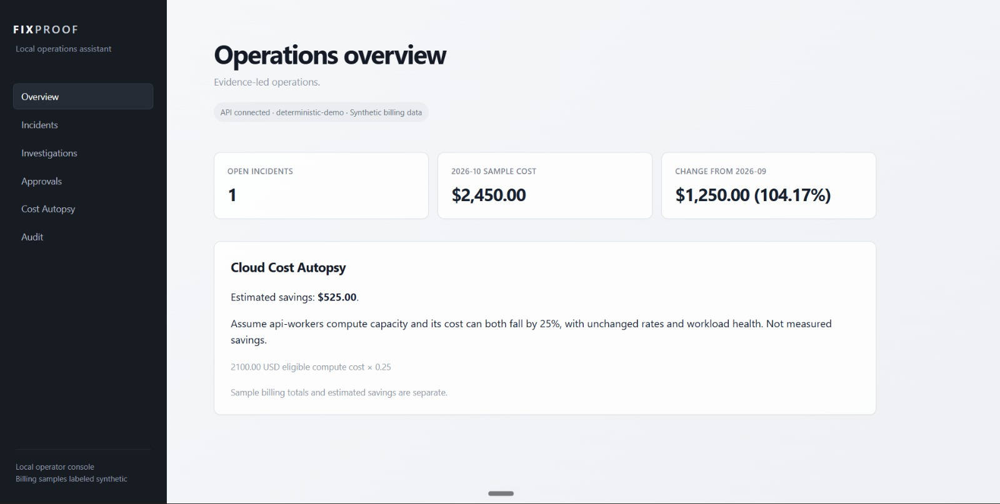
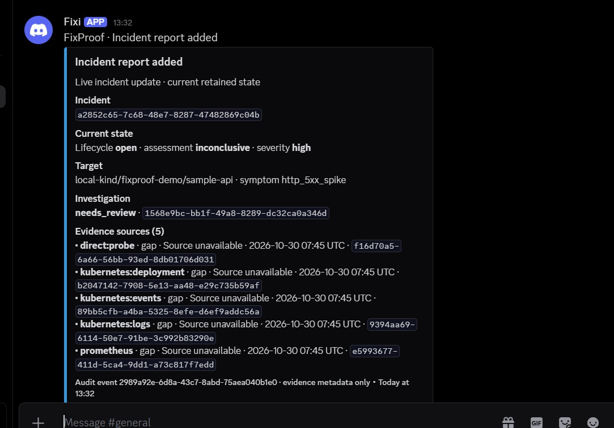
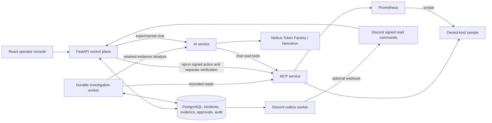

# FixProof

FixProof is a local-first, evidence-grounded DevOps assistant that helps an operator investigate a Kubernetes incident, review one exact restoration proposal, and independently decide whether recovery occurred.

An application can pass readiness checks while users receive errors. Investigating why often means switching between metrics, logs and deployment history. FixProof connects those observations to a reviewable change and a separate recovery check.

## How it works

1. An authenticated operator reports the incident.
2. A durable worker collects bounded metrics, Deployment state, logs, events and probes, retaining them in PostgreSQL.
3. The stateless AI analysis service returns cited hypotheses, contradictions, gaps and uncertainty.
4. An operator reviews and approves an exact restoration proposal.
5. The scoped writer applies the approved change after checking its preconditions.
6. Independent rollout, health-probe and fresh-traffic checks determine recovery; patch success alone is insufficient.

## Screenshots

Operations overview with synthetic billing data and illustrative savings estimates.



Discord incident notification showing retained status and unavailable evidence sources.



## Implementation status

- **Incident investigation:** authenticated intake, durable collection jobs, five bounded evidence sources and validated analysis citations are implemented. Earlier local acceptance covered live investigation and persistence after restart.
- **Approved restoration:** exact proposal review, scoped capabilities, atomic preconditions and replay protection are implemented. One controlled live restore passed earlier acceptance; writes remain disabled by default.
- **Independent verification:** rollout checks, three health probes and a fresh traffic window are implemented. Two complete verified recovery cycles and final release acceptance remain pending.
- **ChatOps:** the chat page, incident drawer and API/AI routes exist, but run selection, live grounding, UUID citations and durable history require further implementation and validation. See [ChatOps](docs/CHATOPS.md).
- **Discord:** optional audit-event delivery and signed read-only commands are implemented. Earlier webhook delivery was reported; live slash-command acceptance remains pending.
- **Cloud costs:** persisted synthetic cost reports exist. Real billing ingestion and optimization execution are planned.

Earlier acceptance does not certify the latest revision. AWS/Terraform/GitHub/Slack integration, arbitrary infrastructure actions and isolated fix-testing environments are outside the demonstrated workflow.

## NVIDIA Nemotron and Nebius Token Factory

- The AI service defaults to `nebius` with `nvidia/NVIDIA-Nemotron-3-Nano-30B-A3B` through the Nebius Token Factory OpenAI-compatible endpoint.
- `NEBIUS_MODEL` and `NEBIUS_BASE_URL` configure the model and endpoint. Live inference requires a real `NEBIUS_API_KEY`; the mock default does not make external model calls.
- The strict investigation path supplies retained, bounded evidence to `/analyze` and rejects unknown or inconsistent citations. Missing sources remain explicit gaps. Citation membership validates a reference, not the truth of a diagnosis.
- Model output remains advisory. Approval, execution and verification use deterministic controls. No benchmark, latency, cost or model-performance result is claimed.

## Local workload and telemetry

The owned kind fixture runs `sample-api` and steady traffic in `fixproof-demo`. `FAIL_MODE=on` makes `/api/work` and `/healthz` return HTTP 500 while `/readyz` stays HTTP 200. MCP gathers Prometheus work-request counters, Deployment/pod state, events, bounded logs and direct probes for API retention.



The API and PostgreSQL own durable state. The separate legacy LangGraph/MemorySaver path is not an approval authority. [Architecture](docs/ARCHITECTURE.md) and [agent orchestration](docs/AGENTIC_ARCHITECTURE.md) explain these boundaries.

## Stack

React, TypeScript and Vite; Python/FastAPI; SQLAlchemy/Alembic with PostgreSQL; LangChain/LangGraph and OpenAI-compatible inference; MCP, Kubernetes/kind, Prometheus and Grafana; Docker Compose, pytest, Vitest and Playwright. The bundled Laya service is a deterministic protocol fixture, not a deployed Laya model.

## Security

- Signed operator sessions protect application access; writes require CSRF and allowed-Origin checks when local demo mode is disabled.
- Approval binds the proposal version, content and expiry. Restoration uses a registered baseline, exact target identity and template hashes, checked through atomic Kubernetes preconditions.
- Internal requests use service authentication. MCP uses namespace-scoped Kubernetes credentials; the optional writer can only get/patch the registered sample Deployment. No developer admin kubeconfig is mounted into application containers.
- Public application ports bind to loopback; model credentials, operator secrets and Kubernetes tokens stay outside Git. This is an owned local demonstration, with production hardening still required. See [Security](docs/SECURITY.md).

## Quick start

Prerequisites: Docker with Compose, Python 3.12+, kind and internet access for image/tool downloads and live Nebius inference. Node 22.12+ and pnpm 10.15.1 are needed only for host frontend development. No local GPU is required by the default remote-inference path.

From the repository root, create `.env` only if it does not already exist, then follow [environment setup](docs/DEVELOPMENT.md#environment-and-startup) before starting the stack:

```sh
cp -n .env.example .env
python3.12 scripts/kind_fixture.py up
python3.12 scripts/configure_investigation.py
# Configure live inference and local database/Grafana credentials in ignored .env.
docker compose -f compose.yaml -f compose.kind.yaml up --build --wait --wait-timeout 180
```

PowerShell uses `Copy-Item .env.example .env` only for a new configuration. Preserve existing credentials and database volumes.

For live investigation, configure:

- **Local credentials:** matching `POSTGRES_PASSWORD`/`DATABASE_URL` and a `GRAFANA_ADMIN_PASSWORD`.
- **Inference:** `AI_LLM_PROVIDER=nebius`, a real `NEBIUS_API_KEY` and `ANALYSIS_ENABLED=true`; `NEBIUS_MODEL` and `NEBIUS_BASE_URL` select the model and endpoint.
- **Operator access:** keep `LOCAL_DEMO_ENABLED=false`. Reader setup provisions `OPERATOR_SECRET`, `SESSION_SIGNING_KEY`, `SERVICE_AUTH_TOKEN` and `SAMPLE_TARGET_UID`.

See environment setup for values and optional integrations; never publish real keys.

Open the console at http://localhost:5173, sign in and report the registered target. API docs are at http://localhost:8000/docs; Prometheus is at http://localhost:9090 and Grafana defaults to http://localhost:3000 (`GRAFANA_PORT` can change it). AI, MCP, PostgreSQL and delivery workers are internal services. Grafana's provisioned dashboard monitors the API process, not a recovery verdict.

## Testing and demo

```sh
docker compose -f compose.checks.yaml run --build --rm api-checks
docker compose -f compose.checks.yaml run --build --rm api-postgres-checks
docker compose -f compose.checks.yaml run --build --rm web-checks
```

These are test commands, not a claim that the current revision passed them. See [development checks](docs/DEVELOPMENT.md#checks-and-contracts) for AI/MCP, formatting, generated contracts and browser tests.

The [demo runbook](docs/DEMO_RUNBOOK.md) separates synthetic smoke, live investigation, approved restoration and independent recovery acceptance. It includes scripts that deliberately fault the owned sample. Keep writes disabled unless performing a reviewed, scoped trial.

## Documentation and license

Licensed under the [Apache License 2.0](LICENSE). Operational references:

[Documentation index](docs/README.md) · [Security](docs/SECURITY.md) · [Discord](docs/DISCORD_INTEGRATION.md) · [kind runbook](infra/kind/README.md)
