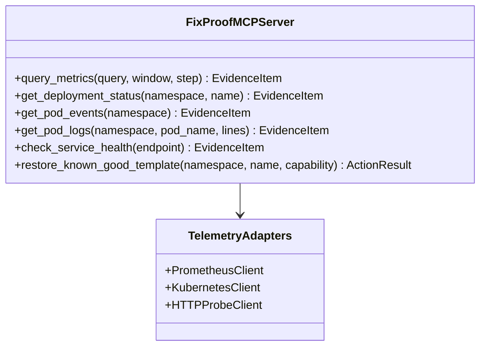

# FixProof — Custom MCP Server Architecture (`apps/mcp`)

> **Location:** `apps/mcp/`  
> **Framework:** Python MCP SDK (`FastMCP`) + FastAPI / Uvicorn  
> **Role:** Telemetry & Infrastructure Gateway for the AI Agent and Control Plane  
> **Port:** `8002` (internal Docker network only)

---

## 1. Why a Custom FixProof MCP Server?

Rather than exposing raw, unconstrained tools (like arbitrary `kubectl exec` or unrestricted Docker sockets), FixProof implements a **domain-specific, bounded MCP server**:
1. **Security Isolation:** Kubernetes credentials (`kubeconfig` scoped to `fixproof-demo`) reside *only* inside `apps/mcp`. The AI service and browser never see cluster credentials.
2. **Standardized Evidence Format:** Every read tool assigns a stable, content-hashed evidence identifier (`EVD-PROM-...`, `EVD-LOG-...`) required by the Nemotron citation engine and persisted in `apps/api` PostgreSQL.
3. **Single Guarded Action:** Only one write action exists (`restore_known_good_template`), which requires a short-lived capability signature from `apps/api`.

---

## 2. Tool Registry Specification



### A. Read Tools (Evidence Gathering)

#### 1. `query_metrics`
* **Purpose:** Query local Prometheus for request error rates and traffic volume.
* **Input Schema:**
  ```json
  {
    "query": "sum(increase(sample_http_requests_total{job='fixproof-sample'}[1m])) by (status_class)",
    "time_window": "1m",
    "step": "15s"
  }
  ```
* **Output:**
  ```json
  {
    "evidence_id": "EVD-PROM-8f92a1",
    "source": "prometheus",
    "observed_at": "2026-10-25T18:00:00Z",
    "metric": "sample_http_requests_total",
    "total_requests": 64,
    "error_requests_5xx": 22,
    "error_ratio": 0.3437,
    "fact": "Over the past 1m, 22 of 64 requests failed with 5xx (34.4% error rate).",
    "trusted": false
  }
  ```

#### 2. `get_deployment_status`
* **Purpose:** Inspect target Deployment revisions, replicas, and pod conditions.
* **Input Schema:**
  ```json
  {
    "namespace": "fixproof-demo",
    "deployment_name": "sample-api"
  }
  ```
* **Output:**
  ```json
  {
    "evidence_id": "EVD-K8S-DEP-4a7b9c",
    "source": "kubernetes:deployment",
    "observed_at": "2026-10-25T18:00:05Z",
    "replicas_desired": 2,
    "replicas_available": 2,
    "current_revision": 2,
    "pod_template_hash": "b96f5787c",
    "env_vars": {"FAIL_MODE": "on"},
    "fact": "Deployment sample-api is at revision 2 with FAIL_MODE=on. 2/2 pods ready."
  }
  ```

#### 3. `get_pod_events`
* **Purpose:** Pull recent warning and error events in the sample namespace.
* **Input Schema:**
  ```json
  {
    "namespace": "fixproof-demo",
    "limit": 10
  }
  ```
* **Output:**
  ```json
  {
    "evidence_id": "EVD-K8S-EVT-12e84d",
    "source": "kubernetes:events",
    "events": [
      {"type": "Normal", "reason": "ScalingReplicaSet", "message": "Scaled up replica set sample-api-b96f5787c to 2"}
    ]
  }
  ```

#### 4. `get_pod_logs`
* **Purpose:** Read bounded, tail-end container logs (strictly capped at 50–100 lines).
* **Input Schema:**
  ```json
  {
    "namespace": "fixproof-demo",
    "pod_name": "sample-api-b96f5787c-x9kz1",
    "lines": 50
  }
  ```
* **Safety:** Strips ANSI escape sequences; truncates lines $> 500$ chars; labels output as untrusted text.
* **Output:**
  ```json
  {
    "evidence_id": "EVD-K8S-LOG-99a32c",
    "source": "kubernetes:pod_logs",
    "pod_name": "sample-api-b96f5787c-x9kz1",
    "lines_returned": 24,
    "log_excerpt": "[ERROR] FAIL_MODE=on: /api/work returned 500 Internal Server Error"
  }
  ```

#### 5. `check_service_health`
* **Purpose:** Direct HTTP probe to test functional health (`/healthz`).
* **Input Schema:**
  ```json
  {
    "endpoint_url": "http://sample-api.fixproof-demo.svc:8080/healthz"
  }
  ```
* **Output:**
  ```json
  {
    "evidence_id": "EVD-PRB-77d10e",
    "source": "direct:probe",
    "status_code": 500,
    "latency_ms": 12,
    "healthy": false,
    "body": "{\"status\":\"error\",\"reason\":\"FAIL_MODE active\"}"
  }
  ```

---

### B. Guarded Mutation Tool (Execution Phase)

#### 6. `restore_known_good_template`
* **Purpose:** The **ONLY** write action in the system. Replaces the current faulty pod template with the trusted, captured baseline template.
* **Input Schema:**
  ```json
  {
    "namespace": "fixproof-demo",
    "deployment_name": "sample-api",
    "expected_bad_template_hash": "b96f5787c",
    "desired_good_template_hash": "74888fbf6",
    "capability_token": "<signed-jwt-or-hmac-from-apps-api>"
  }
  ```
* **Safety Invariants Checked Before Patching:**
  1. Target namespace and deployment name match the allowlist (`fixproof-demo/sample-api`).
  2. The current cluster pod template hash matches `expected_bad_template_hash` (prevents race conditions).
  3. Desired template hash matches the trusted local baseline.
  4. Capability token has not expired and has not been replayed.
* **Execution:**
  - Patches Deployment via Kubernetes API: removes `FAIL_MODE=on`, restores baseline image and flags.
* **Output:**
  ```json
  {
    "status": "succeeded",
    "action": "restore_known_good_template",
    "target": "local-kind/fixproof-demo/sample-api",
    "new_revision": 3,
    "details": {
      "patched_at": "2026-10-25T18:02:10Z",
      "restored_template_hash": "74888fbf6"
    }
  }
  ```

---

## 3. Resource Endpoints

The MCP server exposes standard static/cached resources:
* **`resource://fixproof/baseline-template`**: JSON of the captured known-good pod template recorded at bootstrap.
* **`resource://fixproof/target-schema`**: The registered metadata for `sample-api` (UID, ports, probe paths).

---

## 4. Kubernetes RBAC Configuration

The MCP container authenticates with kind using a scoped ServiceAccount (`infra/kind/mcp-rbac.yaml`):

```yaml
apiVersion: v1
kind: ServiceAccount
metadata:
  name: fixproof-mcp-sa
  namespace: fixproof-demo
---
apiVersion: rbac.authorization.k8s.io/v1
kind: Role
metadata:
  name: fixproof-mcp-role
  namespace: fixproof-demo
rules:
  # Read-only telemetry
  - apiGroups: ["", "apps"]
    resources: ["pods", "pods/log", "events", "services", "replicasets"]
    verbs: ["get", "list", "watch"]
  # Read deployment status
  - apiGroups: ["apps"]
    resources: ["deployments"]
    verbs: ["get", "list", "watch"]
  # Guarded patch ONLY for the sample app
  - apiGroups: ["apps"]
    resources: ["deployments"]
    resourceNames: ["sample-api"]
    verbs: ["patch"]
---
apiVersion: rbac.authorization.k8s.io/v1
kind: RoleBinding
metadata:
  name: fixproof-mcp-binding
  namespace: fixproof-demo
subjects:
  - kind: ServiceAccount
    name: fixproof-mcp-sa
    namespace: fixproof-demo
roleRef:
  kind: Role
  name: fixproof-mcp-role
  apiGroup: rbac.authorization.k8s.io
```

---

## 5. Sync with `apps/api`

This MCP server matches `apps/api` contracts with 100% precision:
1. **Evidence Items:** The output of read tools maps directly into `EvidenceOut` and SQLAlchemy `EvidenceItem` in `apps/api/app/models/domain.py`.
2. **Operations Adapter:** `apps/api/app/services/operations.py` implements `OperationsAdapter`. In live mode, it delegates:
   - `execute(...)` $\to$ calls `restore_known_good_template` on MCP.
   - `verify(...)` $\to$ calls `get_deployment_status`, 3x `check_service_health`, and `query_metrics` on MCP.
   - The returned measurements pass into `Measurement` and `Observation` in `operations.py`.

---

## 6. Directory Structure for `apps/mcp`

```text
apps/mcp/
├── Dockerfile
├── pyproject.toml
├── app/
│   ├── main.py                  # FastMCP application entry point + FastAPI wrapper
│   ├── config.py                # K8s in-cluster / kubeconfig path & Prometheus URL
│   ├── adapters/
│   │   ├── k8s.py               # Kubernetes API client (Deployments, Pods, Logs, Events)
│   │   ├── prometheus.py        # Prometheus HTTP query client
│   │   └── probe.py             # Direct HTTP probe client
│   └── tools/
│       ├── metrics.py           # query_metrics tool
│       ├── k8s_read.py          # get_deployment_status, get_pod_events, get_pod_logs
│       ├── probe.py             # check_service_health tool
│       └── patch.py             # restore_known_good_template tool
└── tests/
    └── test_mcp_tools.py        # Unit tests with mock K8s and Prometheus
```
