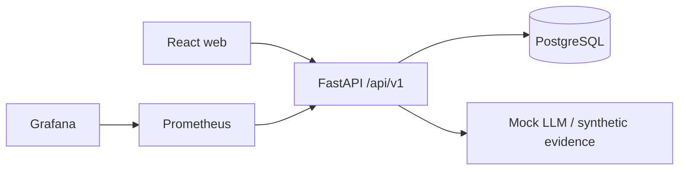
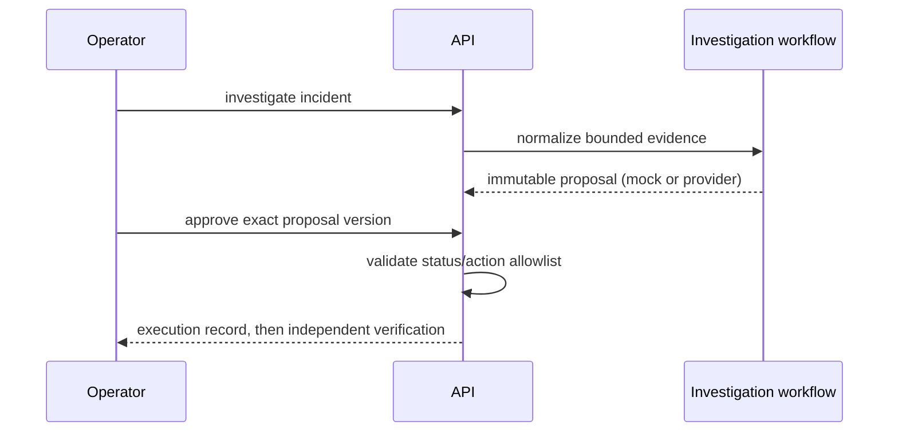

# Architecture

FixProof is a modular monolith: React/Vite serves the operator UI; FastAPI owns domain rules and OpenAPI; PostgreSQL persists approved domain data; Prometheus/Grafana observe the API. The current demo integration is deterministic and local-only.

Trust boundary: UI and logs are untrusted inputs. The LLM can only receive normalized read-only evidence and return validated structured output; it never receives shell or infrastructure credentials. Real cloud/Kubernetes adapters, authentication, secret management, and isolated execution are deferred until Phases 5–8.
