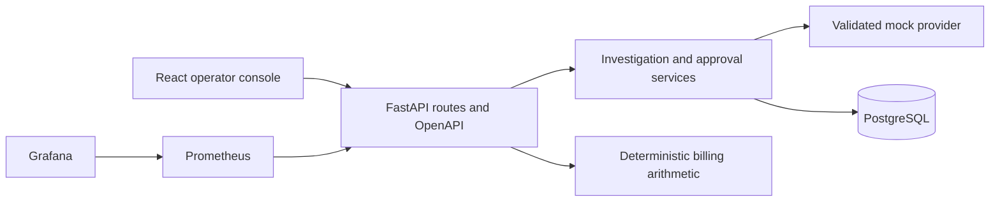

# Architecture

FixProof is a modular monolith. React/Vite owns the operator experience; FastAPI owns contracts and domain rules; PostgreSQL owns durable incident, recommendation, and audit records. SQLite supports isolated unit/integration tests and optional host development. Prometheus and Grafana currently observe the API process.

## Implemented boundaries

Routes handle HTTP input and output; recommendation services enforce lifecycle decisions and transaction boundaries. A provider protocol separates advisory investigation from persistence. The mock provider returns a bounded, schema-validated local proposal with explicitly synthetic, untrusted evidence. No provider has a mutation tool or cloud credentials.

Each investigation persists normalized evidence with source/time, content hash and trust label, while retaining the original proposal JSON for compatibility. Its SHA-256 digest binds recommendation identity, incident, version, action, target, parameters, evidence and expiry. Separate approval decisions bind actor/version/hash/expiry. Approval and execution independently validate the reviewed snapshot and normalized evidence. Reinvestigation supersedes pending or approved earlier proposals and is blocked during a pending execution.

PostgreSQL serializes investigation and decision operations with an incident row lock. The unique incident/version constraint and conditional decision update provide additional safeguards. SQLite is a convenience/test backend; it does not reproduce PostgreSQL row locking. Concurrency tests therefore run against PostgreSQL.

Timeline entries come from retained audit events, protected by append-only database triggers. Collection reads are bounded with limit/offset or route-bound keyset cursors and newest-first timestamp/UUID ordering.

Phase 2 persists billing analyses and Decimal/Numeric source rows together with their audit events. Idempotency records bind a server actor/key to a route/body and replay the original result. Execution and verification commit a pending claim before adapter invocation so a crash does not silently repeat an action. These are separate records and outcomes; verification requires attributable, fresh post-execution measurements consistent with their numeric thresholds. The default adapter records an explicit unavailable execution failure and performs no infrastructure mutation.

## Contracts and runtime

The API exports a committed OpenAPI snapshot. The frontend generates TypeScript definitions from that snapshot and derives response types from paths. CI checks both generated artifacts for drift, alongside lint, build, SQLite/PostgreSQL tests, development-image tests, and an HTTP stack smoke test.

Runtime images exclude test tools. Separate development targets contain test dependencies and sources. The web runtime serves SPA routes on port 8080. Compose exposes the console, API, and monitoring only on loopback. API readiness checks database connectivity and the current migration revision.

## Remaining product layers

Production authentication/project authorization, isolated candidate testing, pending-operation reconciliation/workers, real metrics/log/deployment collectors, and infrastructure/measurement adapters remain future work. A server-owned local role resolver provides the Phase 2 authorization boundary; it is not production login. LOCAL_DEMO_ENABLED=false fails application access closed until authentication is configured. At-most-one invocation through the API does not guarantee exactly-once delivery to an external infrastructure system.

The target product sequence remains detect → investigate → explain → propose → test where practical → approve → execute → verify → report. This scaffold implements only part of that sequence and must not report an actual infrastructure change or recovered workload.
