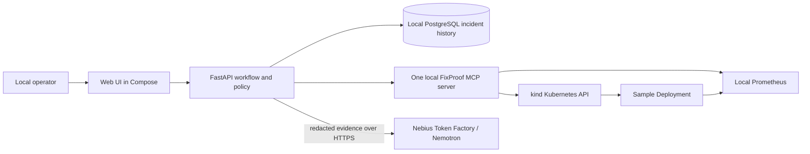

# Architecture

## Current and target boundaries

Today the repository is a React/Vite UI, FastAPI API, PostgreSQL database, and Compose-hosted Prometheus/Grafana. The API returns a hard-coded investigation and synthetic cost data. The components below are the **target MVP**, not deployed components.

FastAPI owns incident state, evidence snapshots, proposal validation, approval, execution orchestration, and verification decisions. The MCP server owns narrowly scoped infrastructure access. The UI never accesses cluster credentials or Nebius keys. Nemotron receives bounded, redacted evidence and returns advisory structured analysis; it never calls mutation tools or decides that recovery occurred. PostgreSQL is the local source of truth. Grafana can help a developer inspect metrics, but it is not a verification authority.

## One incident workflow

1. Deploy a small HTTP sample app in namespace `fixproof-demo`. `/readyz` checks process readiness, `/healthz` checks functional health, and `/metrics` exposes request/error counters. Save a known-good Deployment pod template and identify its revision and image digest.
2. Deliberately introduce a configuration problem through a new Deployment revision, using `FAIL_MODE=on` for the first fixture. Pods stay process-ready to receive sample traffic, but application requests and functional `/healthz` fail. This yields measurable 5xx responses while the earlier template remains available. Record the fault injection time and expected bad revision. Reset returns to the known-good baseline.
3. Start an investigation for that target. FastAPI calls MCP read tools for bounded Prometheus queries, Deployment/ReplicaSet status, pod states, events, and a capped log window. It stores source, UTC observation time, collection window, target identity, content hash, and trust label for each snapshot.
4. FastAPI sends a minimal redacted evidence bundle to Nebius. A provider adapter calls the configured NVIDIA Nemotron model via HTTPS. Validate the response against a strict schema: hypotheses, evidence IDs supporting and contradicting each, uncertainty, and one allowed action proposal. Invalid or unavailable model output leaves the incident open for manual review.
5. The operator reviews evidence and approves the exact immutable proposal hash/version, target, expected bad state, desired known-good template, and expiry. Approval is a separate backend transaction. Reject/expire also produce audit events.
6. FastAPI calls the MCP mutation tool only after checking approval, allowlist, scope, target identity, current resource version/template hash, and idempotency key. It passes a short-lived, one-use signed capability bound to that execution and proposal; MCP validates it before its own target/state checks. For the MVP the only mutation is restoring the captured known-good Deployment pod template in `fixproof-demo`. If state has drifted, stop and require a new proposal; do not silently choose another revision.
7. Record the API mutation outcome separately. Verify against a fresh rollout observation, a real sample `/healthz` request, and a post-action Prometheus window compared with the pre-action baseline. Use bounded retries and a deadline. Report `verified`, `verification_failed`, or `inconclusive` with measured values; a successful patch alone is never recovery.

## Local topology and access

Compose runs web, API, database, Prometheus, and the single MCP service. `kind` runs the sample app. The bootstrap work must explicitly bridge Compose containers to kind: use a host-mapped sample endpoint for Prometheus and verification, and a generated Kubernetes client configuration for the MCP container whose API-server address is reachable from its network. On Windows Docker Desktop, `host.docker.internal` can address the published kind API port; Linux needs an equivalent documented host gateway. Validate both paths from **inside containers**, not just the host.

The MCP Kubernetes credential must be scoped by a namespace Role/RoleBinding to the sample resources and verbs. Do not mount the host's cluster-admin kubeconfig or Docker socket. Provision/refresh the scoped credential through a local bootstrap command and keep it out of Git. Prometheus is read-only to MCP. Only the MCP container receives Kubernetes credentials; only the API container receives the Nebius key. Bind published interfaces to loopback where feasible.

## Invariants

- The model proposes; backend policy decides what can be approved and executed.
- Evidence and model output are untrusted input. Normalize, cap, redact, and retain provenance before any inference call.
- The stored proposal, approval, execution, and verification result are distinct records. Every transition is audited with actor and time.
- Retries cannot run an approved action twice. Current cluster state is checked immediately before mutation.
- Health checks and metrics used for verification are collected after execution and linked to the execution record.
- No generic shell, arbitrary `kubectl`, arbitrary MCP tool invocation, or production cluster target exists in the MVP.

Optional GitHub commit/deployment context is a later read-only adapter. Cloud Cost Autopsy is existing synthetic demo code and does not gate this workflow.
