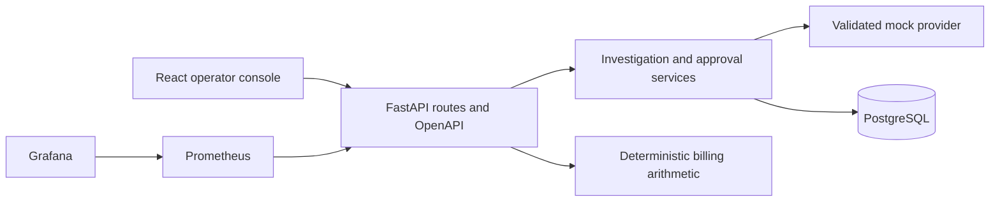

# Architecture

FixProof is a modular monolith. React/Vite owns the operator experience; FastAPI owns contracts and domain rules; PostgreSQL owns durable incident, recommendation, and audit records. SQLite supports isolated unit/integration tests and optional host development. Prometheus and Grafana currently observe the API process.

## Implemented boundaries

Routes handle HTTP input and output; recommendation services enforce lifecycle decisions and transaction boundaries. A provider protocol separates advisory investigation from persistence. The mock provider returns a bounded, schema-validated local proposal with explicitly synthetic, untrusted evidence. No provider has a mutation tool or cloud credentials.

Each investigation retains its evidence snapshot inside a recommendation version. Its SHA-256 digest binds the recommendation ID, incident, version, action, target, parameters, evidence, and expiry. The caller must submit the reviewed digest when approving. The backend recomputes it, checks expiry, checks the latest version and allowed demo target/action, and records a server-labelled local identity. Reinvestigation supersedes pending or approved earlier versions.

PostgreSQL serializes investigation and decision operations with an incident row lock. The unique incident/version constraint and conditional decision update provide additional safeguards. SQLite is a convenience/test backend; it does not reproduce PostgreSQL row locking. Concurrency tests therefore run against PostgreSQL.

Timeline entries come from retained audit events; evidence endpoints return retained snapshots rather than generating new facts. Collection reads are bounded with limit/offset and stable ordering.

## Contracts and runtime

The API exports a committed OpenAPI snapshot. The frontend generates TypeScript definitions from that snapshot and derives response types from paths. CI checks both generated artifacts for drift, alongside lint, build, SQLite/PostgreSQL tests, development-image tests, and an HTTP stack smoke test.

Runtime images exclude test tools. Separate development targets contain test dependencies and sources. The web runtime serves SPA routes on port 8080. Compose exposes the console, API, and monitoring only on loopback. API readiness checks database connectivity and the current migration revision.

## Remaining product layers

Normalized investigations/evidence tables, durable cost analyses, authenticated identities, approval records with independent expiry, execution/idempotency records, isolated test runs, verification measurements, workers, real metrics/log/deployment collectors, and cloud/Kubernetes adapters remain future work. Recommendation snapshots are an initial persistence boundary, not the final evidence model.

The target product sequence remains detect → investigate → explain → propose → test where practical → approve → execute → verify → report. This scaffold implements only part of that sequence and must not report an actual infrastructure change or recovered workload.
