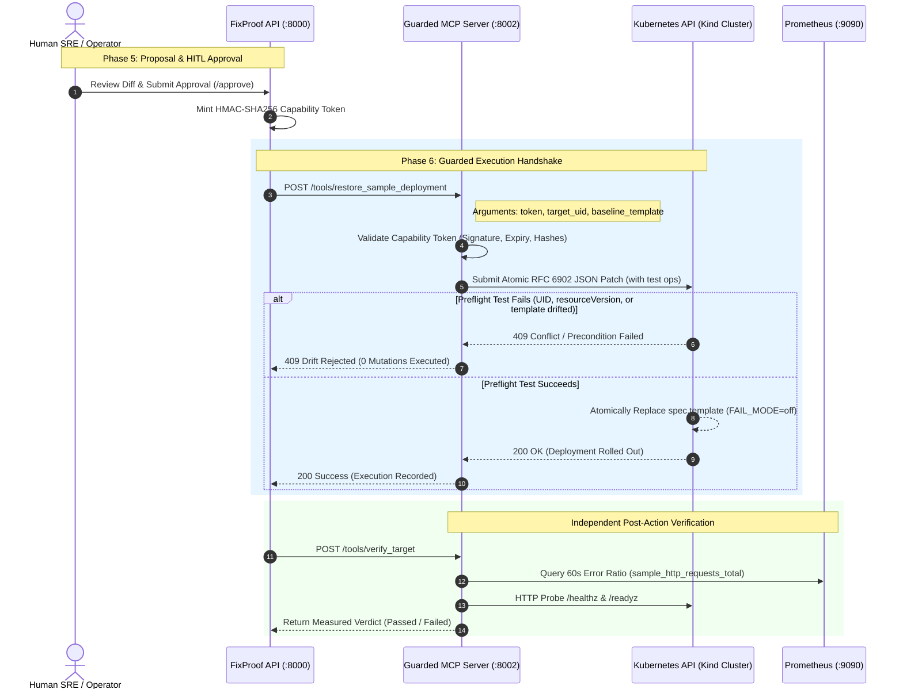

# Phase 6: Guarded Execution, MCP Safety & RBAC

This document outlines the architecture, security invariants, and verified implementation of **Phase 6: Infrastructure & Guarded Execution**, owned by **Member 2** in accordance with `FixProof_Four_Member_Work_Division.pdf` and `4_member_final_plan.pdf`.

---

## 1. Architectural Overview & Responsibility

In FixProof, AI models (NVIDIA Nemotron 30B via Nebius Token Factory) analyze telemetry and advise on incident resolutions. However, **agents never mutate infrastructure directly**. 

Phase 6 provides the **guarded execution boundary**:
- **MCP Server (`apps/mcp`)**: An isolated microservice implementing the Model Context Protocol that enforces authorization, preflight checks, and verified rollbacks.
- **Human-In-The-Loop (HITL) Gate**: The API issues a single-use, cryptographic capability token only after human review and approval.
- **Least-Privilege Kubernetes Writer**: An isolated ServiceAccount constrained strictly to `patch` the target Deployment and forbidden from deleting resources or touching other workloads/namespaces.
- **Atomic Preflight Drift Detection**: Preflight checks executed inside a single Kubernetes RFC 6902 JSON Patch transaction with `test` operations.
- **Out-of-Band Verification**: Post-patch health confirmation combining Prometheus PromQL error ratios and live HTTP probes.

---

## 2. End-to-End Execution Flow



---

## 3. The 4 Security Invariants

### 1. Scoped Kubernetes RBAC Boundary
The execution service never mounts cluster-admin credentials. It is separated into two short-lived ServiceAccounts:
- **`fixproof-reader`**: `get`, `list` on deployments, pods, and services in `fixproof-demo`.
- **`fixproof-writer`**: Bound by `RoleBinding` to `fixproof-writer` Role:
  ```yaml
  apiVersion: rbac.authorization.k8s.io/v1
  kind: Role
  metadata:
    name: fixproof-writer
    namespace: fixproof-demo
  rules:
    - apiGroups: ["apps"]
      resources: ["deployments"]
      resourceNames: ["sample-api"]
      verbs: ["get", "patch"]
  ```
- **Verified via `scripts/check_writer_scope.py`:**
  - `writer can patch sample`: **PASS**
  - `writer cannot patch other deployment` (e.g. `sample-traffic`): **PASS**
  - `writer cannot patch other namespace` (e.g. `kube-system`): **PASS**
  - `writer cannot delete sample`: **PASS**
  - `reader cannot patch sample`: **PASS**

### 2. Cryptographic Capability Token Handshake
Every mutation request requires an HMAC-SHA256 capability token:
$$\text{token} = \text{base64url}(\text{payload}) \mathbin{\Vert} \text{HMAC-SHA256}_{K}(\text{payload})$$

The payload strictly binds:
```json
{
  "sub": "fixproof-execution",
  "proposal_id": "<UUID>",
  "target_uid": "<Deployment-UID>",
  "template_hash": "<SHA256-of-trusted-baseline>",
  "exp": 1730248200
}
```
The MCP tool verifies the signature using constant-time comparison (`hmac.compare_digest`), checks expiry, and matches `template_hash` against the template payload.

### 3. Atomic Preflight Drift Protection
To eliminate Time-of-Check to Time-of-Use (TOCTOU) race conditions, preflight checks are performed **inside the Kubernetes JSON Patch itself** via RFC 6902 `test` operations:
```json
[
  { "op": "test", "path": "/metadata/uid", "value": "cd99902b-6f48-425a-a9c3-b3d611034813" },
  { "op": "test", "path": "/metadata/resourceVersion", "value": "104" },
  { "op": "test", "path": "/spec/template", "value": <observed_faulty_template> },
  { "op": "replace", "path": "/spec/template", "value": <known_good_baseline_template> }
]
```
If the deployment was modified, deleted, or hotfixed between approval and execution, the Kubernetes API server natively rejects the patch.

### 4. Independent Verification
Patch success does not equate to incident recovery. The MCP server independently executes verification probes over a 60-second window:
1. **Traffic Error Ratio**: Queries Prometheus (`sample_http_requests_total{status="500"}` / total). Recovery requires $\ge 20$ requests and $< 1\%$ 5xx errors.
2. **Health Probes**: Direct HTTP calls to `/healthz` and `/readyz` returning status 200.

---

## 4. Codex Audit & Resolved Regressions

During the review of merged PR #13 code, four critical blocking issues were identified and resolved:

| # | Component | Root Cause | Fix Applied |
|---|-----------|------------|-------------|
| 1 | `apps/ai` / `.env` | Unsupported model name `llama-3.3-70b-versatile` resulted in 50-second timeouts against Nebius Token Factory. | Updated `.env` to `nvidia/NVIDIA-Nemotron-3-Nano-30B-A3B`. |
| 2 | `apps/mcp` / `.env` | `EXECUTION_SIGNING_KEY` was missing from `.env`, causing capability token verification to fail closed. | Provisioned cryptographic signing key and mounted it via `compose.execution.yaml`. |
| 3 | `apps/api` / `.env` | `LIVE_EXECUTION_ENABLED=true` was hardcoded in `.env`, breaking unit tests that assert fail-closed execution behavior. | Set `LIVE_EXECUTION_ENABLED=false` as default; only enabled explicitly during execution overlay runs. |
| 4 | `apps/api/tests` | Missing test isolation caused `test_api.py` and `test_lifecycle.py` to fail with `401 Unauthorized` across 38 tests. | Added `monkeypatch.setattr(settings, "local_demo_enabled", True)` to `conftest.py`. |

---

## 5. Verification & Test Evidence

### Test Suites
- **MCP Test Suite (`apps/mcp`)**: **31 passed in 4.56s**
  - Preflight drift rejection (`test_restore_guard.py`)
  - Verification & metrics checks (`test_verification.py`, `test_metrics.py`)
  - Live bounds & token validation (`test_live_bounds.py`)
- **API Test Suite (`apps/api`)**: **91 passed, 8 skipped (Postgres-only) in 40.58s**
  - Proposal generation, approval contracts, and execution failure handling (`test_live_proposals.py`)
  - Full intake, audit immutability, and lifecycle operations (`test_lifecycle.py`)

### RBAC Scope Output (`scripts/check_writer_scope.py`)
```
writer can patch sample: pass
writer cannot patch other deployment: pass
writer cannot patch other namespace: pass
writer cannot delete sample: pass
reader cannot patch sample: pass
```

---

## 6. File Ownership Directory

```
apps/mcp/
├── app/
│   ├── adapters/
│   │   ├── kubernetes.py          # Atomic JSON Patch with RFC 6902 test ops
│   │   ├── prometheus.py          # PromQL query adapter for error ratios
│   │   └── probe.py               # Direct HTTP healthz/readyz probe
│   └── tools/
│       ├── capability.py          # HMAC-SHA256 token verification
│       ├── patch.py               # Guarded restore patch tool
│       └── verification.py        # Verification orchestrator
└── tests/
    ├── test_restore_guard.py      # Preflight rejection tests
    ├── test_verification.py       # Metrics probe tests
    └── test_live_bounds.py        # Token signature tests

infra/kind/
├── mcp-writer.yaml                # Least-privilege writer Role & Binding
└── mcp-reader.yaml                # Read-only collector Role & Binding

compose.execution.yaml             # Docker Compose overlay for execution tokens
scripts/check_writer_scope.py      # Automated RBAC verification check
```

