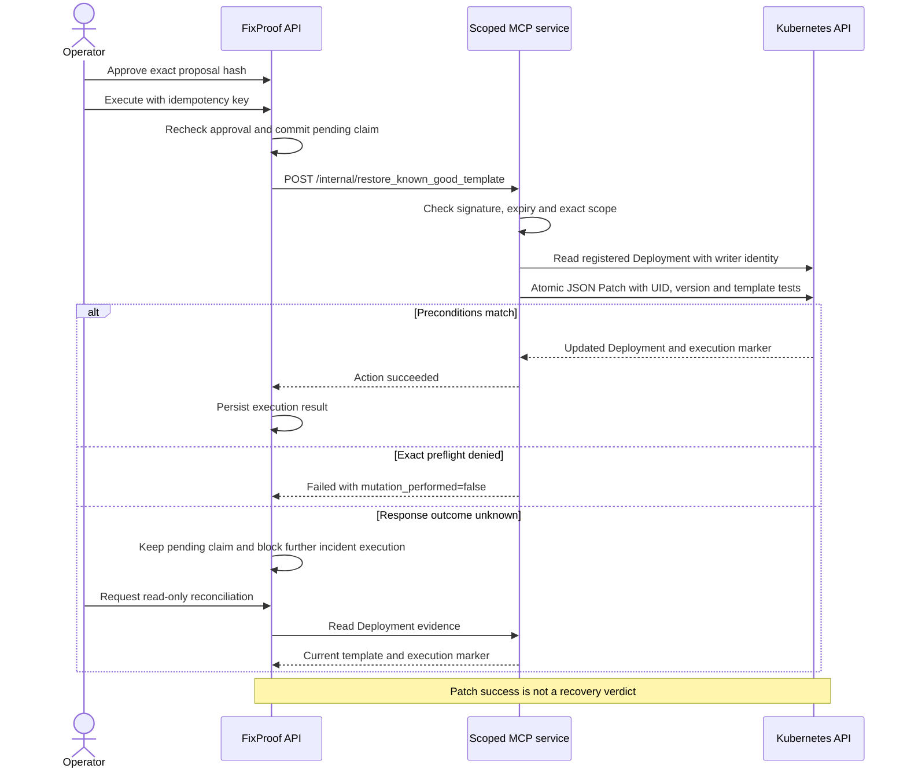

# Guarded execution, MCP safety and Kubernetes permissions

The execution path restores one registered sample Deployment to its independently captured healthy template. Implementation and automated tests are separate from live acceptance; see the [approval and execution handoff](APPROVAL_EXECUTION_HANDOFF.md) for observed results.

## Execution boundary

The API owns proposal construction, exact operator approval, durable execution claims and audit records. MCP independently checks the signed capability and current Kubernetes state. AI output never grants approval, selects the trusted baseline or supplies a patch.

## Separate Kubernetes identities

Only MCP mounts Kubernetes credentials. The developer kubeconfig is not mounted into application containers.

| Identity | Namespace | Permissions |
|---|---|---|
| `fixproof-reader` | `fixproof-demo` | Get `sample-api`; get/list ReplicaSets, pods and events; get pod logs |
| `fixproof-writer` | `fixproof-demo` | Get and patch only Deployment `sample-api` |

The writer Role has `resourceNames: [sample-api]` and verbs `[get, patch]`. It cannot delete the sample or patch another Deployment or namespace. The reader cannot patch. `scripts/check_writer_scope.py` checks these boundaries using the scoped credentials.

The opt-in `compose.execution.yaml` overlay mounts the writer token only into MCP and supplies a separate execution-signing key only to API and MCP. Removing the overlay removes the writer mount and disables live execution.

## Exact capability

Every restore requires a signed capability with these exact claims:

| Claims | Bound value |
|---|---|
| `execution_id`, `proposal_hash` | Durable execution and reviewed proposal |
| `cluster`, `namespace`, `deployment`, `uid` | Registered sample identity |
| `resource_version` | Approved Kubernetes state |
| `expected_bad_template_hash`, `desired_good_template_hash` | Exact observed and trusted templates |
| `expires_at` | Integer expiry within a 60-second lifetime |

The API signs the encoded claims with HMAC-SHA256. MCP uses constant-time signature comparison and rejects unexpected claims, expired capabilities and any mismatch between claims and request fields. Capability contents and keys must not be logged.

## Atomic preconditions and replay

MCP validates the desired template hash and the sample shape, derives the expected faulty template and reads the current Deployment. It requires the exact registered UID, resource version and faulty template. The patch itself contains Kubernetes JSON Patch `test` operations for UID, resource version and template before replacing the template and adding `fixproof.dev/execution-id`.

Both preflight and atomic tests are required: the initial read alone cannot prevent drift between checking and patching. A failed test causes no mutation. The signed state and execution marker prevent same-execution replay from applying another patch.

The API commits its pending claim before sending the request. The same idempotency key replays the original response; another key cannot repeat the recommendation. While a live claim remains pending, no other recommendation for that incident can execute.

## Unknown outcomes

Timeouts and interrupted responses retain a pending execution. Reconciliation only reads current evidence. Matching UID, execution marker and trusted template confirm the action. An unchanged or drifted Deployment remains pending, because absence of an observed patch does not prove an in-flight request cannot complete. No reconciliation path submits another patch.

## Verification boundary

A successful patch records `execution_succeeded`, not recovered status. Independent rollout, health-probe and traffic-window verdicts are a separate workflow. The execution acceptance script does not invoke `/verify`, auto-close incidents or certify UI/release behavior.

## Checks and local acceptance

- API SQLite: 99 passed, eight PostgreSQL-only skipped.
- Isolated PostgreSQL: 107 passed, including migrations, concurrency, audit and replay.
- MCP: 33 passed, including capability rejection and atomic patch replay tests.
- Writer scope: registered sample patch allowed; other Deployment/namespace patch, deletion and reader patch denied.

For live rejection, expiry, drift, capability and restore results, use the [acceptance record](APPROVAL_EXECUTION_HANDOFF.md). Run `scripts/smoke_execution.py` only against the owned fixture with the execution overlay enabled and a temporary 60-second proposal TTL. Restore the normal stack afterward. Tests preserve the application database volume; isolated database checks use a separate disposable container.
