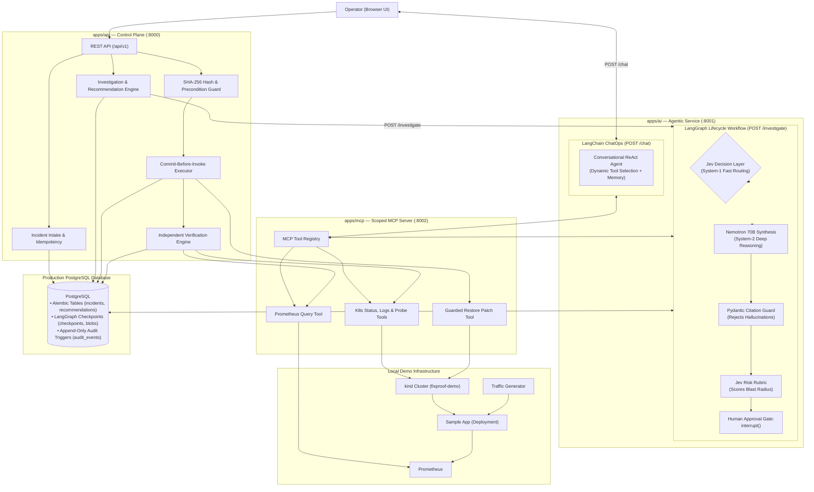
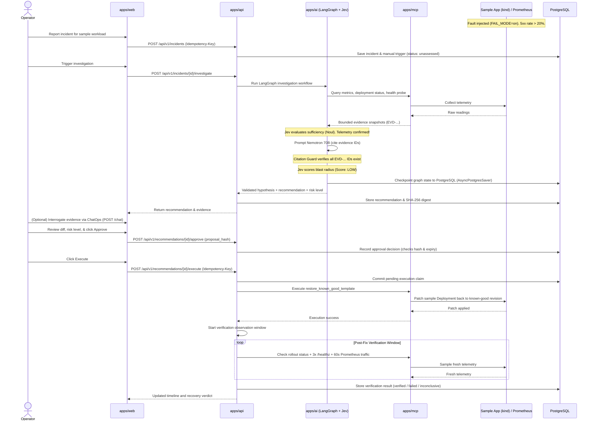

# FixProof — Project Blueprint

> **Purpose:** Master blueprint and single source of truth for the team while building and submitting FixProof.  
> **Status:** Fully correlated with `docs/IMPLEMENTATION_PLAN.md`, `agentic_architecture/`, and active codebase.  
> **Repository:** Monorepo (`pnpm` workspaces for frontend/infra, Python for API/AI/MCP).  
> **Architecture:** Web (React 19 / Vite) + API Control Plane (FastAPI) + AI Service (LangGraph + Jev + LangChain + Nemotron via Nebius) + MCP Server (Python SDK).  
> **Scope:** Frozen MVP: One reproducible, local Kubernetes (`kind`) incident with verified empirical recovery.

---

## 1. Project Overview

### What is FixProof?
FixProof is a local-first, self-hosted AI DevOps and SRE assistant for solo developers and engineering teams. It accepts an incident from a local Kubernetes cluster, collects real Prometheus and Kubernetes telemetry through a single restricted **Model Context Protocol (MCP)** server, executes an evidence-cited investigation using **NVIDIA Nemotron** via **Nebius Token Factory**, requires **exact human approval** with cryptographic binding, executes one guarded remediation action, and independently **verifies recovery** with fresh rollout, probe, and metric signals.

### Problem It Solves
When a service breaks after a deployment, engineers manually shuffle between dashboards, logs, pod events, and terminal commands. AI tools often make this worse by hallucinating commands or blindly declaring "fixed." FixProof solves this with **Verified Remediation**:
1. **Advisory AI Boundary:** The AI possesses zero direct write/mutation authority.
2. **Cryptographic Binding:** Every recommendation binds to a deterministic SHA-256 digest of the exact parameters and target.
3. **Commit-Before-Invoke:** The API commits a durable execution claim before touching infrastructure.
4. **Independent Empirical Verification:** FixProof never trusts a patch just because the API succeeded; it mathematically measures post-fix health and traffic before declaring recovery.

### One-Line Pitch
**FixProof connects deployment incidents to real runtime evidence, proposes cryptographically bound remediations for human approval using NVIDIA Nemotron and Jev, and independently verifies recovery with fresh Prometheus metrics.**

---

## 2. Frozen MVP Scope

### Included in MVP
- **Local Kubernetes Runtime (`kind`):** Sample microservice deployed in namespace `fixproof-demo`.
- **Deliberate Config Fault:** A new Deployment revision introduces `FAIL_MODE=on`. Pods stay process-ready (`/readyz`), but `/api/work` returns $>20\%$ HTTP 5xx errors and functional `/healthz` fails.
- **Traffic Generator:** Generates $\ge 1\text{ req/s}$ to provide a statistically valid metric baseline.
- **Incident Intake:** Authenticated manual operator reporting (starts `unassessed`; deduplicates by target UID and symptom).
- **One Controlled MCP Server (`apps/mcp/`):** Scoped namespace RBAC (no `cluster-admin`, no docker socket) exposing bounded read tools for Prometheus metrics, K8s Deployment/ReplicaSet status, pod logs, and direct probes.
- **Dual AI Engine:**
  - **System-1 (Jev / TypeSafe AI):** Fast, millisecond, non-generative decisions (`Choice`, `Score`, `Noul`) for incident triage, LangGraph branching, and fix risk scoring.
  - **System-2 (NVIDIA Nemotron 70B via Nebius Token Factory):** Deep causal reasoning, timeline synthesis, and mandatory evidence citations.
- **Trusted Known-Good Baseline:** The known-good pod template is captured during bootstrap. The AI is *never* asked to generate raw Kubernetes YAML.
- **Exact Human Approval:** UI reviews exact diff, risk score, and SHA-256 digest. Approval is rejected if target state has drifted.
- **One Guarded Remediation Action:** Restores the captured known-good pod template on the sample Deployment using a one-use capability.
- **Independent Recovery Verification:** Fresh post-patch window: Deployment rollout available + 3 consecutive successful `/healthz` probes + 60-second Prometheus window ($\ge 20$ requests, $<1\%$ 5xx).
- **Production Persistence:** Containerized PostgreSQL with a named volume (`postgres_data`), durable LangGraph checkpoints (`AsyncPostgresSaver`), row locks (`with_for_update()`), and database triggers blocking `UPDATE` or `DELETE` on audit events.

### Explicitly Excluded (Post-MVP)
- GitHub / CI/CD commit scraping (deferred post-MVP to guarantee shipping).
- CloudWatch / AWS / multi-cloud integrations.
- Arbitrary shell script or CLI execution.
- Multi-agent swarms (one structured graph/workflow is used).
- Full AWS billing ingestion (existing Cloud Cost Autopsy remains a labeled synthetic feature).

---

## 3. Technology Stack & Framework Division

| Layer | Technology | Responsibility in FixProof |
|---|---|---|
| **Monorepo** | `pnpm` Workspaces + Docker Compose | Workspace management and local multi-service orchestration |
| **Operator UI** | React 19 + Vite + TypeScript | Incident dashboard, evidence viewer, diff inspection, approval gate, and verification timeline |
| **Control Plane API** | FastAPI + SQLAlchemy 2.0 + Pydantic | REST API, state machine, idempotency, approval locking, execution coordination, and verification engine |
| **Durable Database** | PostgreSQL 16 (Primary) + Named Volume | Persistent incident history, Alembic migrations (`0001`–`0003`), LangGraph checkpoints, and immutable audit trail |
| **Tool Server (MCP)** | Python MCP SDK (`FastMCP`) | Standardized read-only telemetry tools + one guarded patch tool with namespace-scoped RBAC |
| **Lifecycle Orchestration** | LangGraph + `AsyncPostgresSaver` | Multi-step investigation state machine, retry logic, and Human-in-the-Loop pause (`interrupt()`) checkpointed to Postgres |
| **Fast System-1 Decisions** | Jev (TypeSafe AI) | Typed, millisecond evaluations (`Choice`, `Score`, `Noul`) for symptom triage, graph routing, and fix risk scoring |
| **ChatOps & Tool Selection**| LangChain `create_agent` | Fluid, conversational ReAct assistant for interactive operator Q&A (`POST /chat`) with conversation memory |
| **Deep System-2 Reasoning** | NVIDIA Nemotron 70B (Nebius Token Factory) | `nvidia/llama-3.1-nemotron-70b-instruct` over HTTPS for causal analysis and evidence citations |
| **Telemetry / Metrics** | Prometheus v3 | Scrapes sample workload counters (`sample_http_requests_total`) and API metrics |
| **Target Workload** | Local Kubernetes (`kind`) | Hosts `fixproof-demo` namespace, sample HTTP app, and traffic generator |

---

## 4. Repository Structure

```text
fixproof/
├── apps/
│   ├── web/                   # React 19 / Vite frontend operator console
│   ├── api/                   # FastAPI control plane (migrations, routes, models, services)
│   ├── ai/                    # Agentic service (LangGraph + Jev + LangChain + Nemotron via Nebius)
│   ├── mcp/                   # Python MCP server (K8s and Prometheus tool registry)
│   └── sample/                # Sample microservice for kind (/readyz, /healthz, /api/work, /metrics)
│
├── infra/
│   ├── kind/                  # Kind cluster config, deploy manifests, fault/reset scripts
│   ├── prometheus/            # Prometheus configuration and scraping rules
│   └── grafana/               # Provisioned dashboards
│
├── agentic_architecture/      # Detailed agentic & tooling specifications
│   ├── README.md              # System topology and triad model
│   ├── MCP_ARCHITECTURE.md    # Custom FastMCP server blueprint
│   └── AI_AGENT_ARCHITECTURE.md # LangGraph, Jev, and Nemotron design
│
├── docs/                      # Authoritative specifications
│   ├── PROJECT_BLUEPRINT.md   # This master blueprint
│   ├── IMPLEMENTATION_PLAN.md # 8-phase execution roadmap and exit gates
│   ├── INITIAL_INCIDENT.md    # Workload fault and recovery thresholds
│   ├── INCIDENT_INTAKE.md     # Reporting and triage specifications
│   ├── API_CONTRACTS.md       # API surface and serialization rules
│   ├── DATABASE_SCHEMA.md     # Migration history and table constraints
│   ├── SECURITY.md            # Boundary enforcement and capability tokens
│   └── DEMO_RUNBOOK.md        # Scripted demo runbook
│
├── scripts/                   # Smoke tests and validation utilities
├── compose.yaml               # Full local deployment (web, api, db, prometheus, grafana)
├── compose.checks.yaml        # Isolated container test suite
├── package.json
└── pnpm-workspace.yaml
```

---

## 5. System Architecture



---

## 6. Service Responsibilities

### `apps/web` (Frontend)
- Renders active incidents, trigger sources (`manual` / `prometheus`), and lifecycle state.
- Displays evidence snapshots (metrics, logs, events) with stable evidence IDs.
- Presents the AI diagnosis, citations, Jev risk score (`LOW`, `MEDIUM`, `HIGH`), and exact proposed YAML diff.
- Requires operator to review and approve the exact SHA-256 proposal hash.
- Provides an interactive chat sidebar for conversational Q&A with the LangChain ChatOps agent.
- Displays live recovery status (`verifying` $\to$ `verified`, `failed`, or `inconclusive`).

### `apps/api` (Control Plane)
- Central authority for incident lifecycle, idempotency, and audit events.
- Validates operator sessions and rejects unauthorized actions.
- Resolves target workloads against allowlisted configurations.
- Enforces SHA-256 approval digests and target UID / resource version preconditions.
- Commits durable execution claims before invoking the patch.
- Evaluates fresh post-patch signals and records final recovery verdict.

### `apps/ai` (AI Agent Service)
- **Lifecycle Pipeline (LangGraph):** Orchestrates telemetry collection, Jev sufficiency checks, Nemotron deep causal reasoning, citation verification, and human approval interrupts checkpointed to PostgreSQL.
- **Fast Decisions (Jev):** Millisecond evaluations of symptom classification, routing, and fix blast radius.
- **ChatOps (LangChain `create_agent`):** Real-time conversational assistance allowing the operator to interrogate logs and metrics.
- Recommends allowlisted actions (`restore_known_good_template`); never generates raw YAML.

### `apps/mcp` (Tool Server)
- Connects to `kind` via a namespace-scoped `ServiceAccount` and to Prometheus via HTTP.
- **Read Tools:** `query_metrics`, `get_deployment_status`, `get_pod_events`, `get_pod_logs`, `check_service_health`.
- **Mutation Tool:** `restore_known_good_template` (restricted strictly to the sample Deployment, requiring a signed capability from the API).

---

## 7. End-to-End Incident Flow



---

## 8. Data Model

The data model uses PostgreSQL, managed by Alembic migrations (`0001`–`0003` existing, `0004` planned):

| Table | Key Fields | Purpose |
|---|---|---|
| `incidents` | `id`, `target_id`, `status`, `severity`, `title`, `summary`, `assessment` | Workload incident record |
| `incident_triggers` | `id`, `incident_id`, `source`, `source_time`, `reporter`, `measurements` | Immutable record of trigger (`manual` or `prometheus`) |
| `investigations` | `id`, `incident_id`, `provider`, `mode`, `result`, `status` | Normalized investigation session |
| `evidence_items` | `id`, `investigation_id`, `source`, `observed_at`, `fact`, `content_hash` | Attributable telemetry snapshot with stable ID |
| `recommendations` | `id`, `incident_id`, `version`, `proposal_hash`, `action`, `target`, `parameters` | Versioned, hashed fix proposal |
| `approvals` | `id`, `recommendation_id`, `actor`, `proposal_hash`, `decision`, `expires_at` | Explicit human sign-off |
| `executions` | `id`, `recommendation_id`, `adapter`, `proposal_hash`, `status`, `started_at` | Durable execution claim and outcome |
| `verification_results`| `id`, `execution_id`, `status`, `criteria`, `observed_signals` | Post-patch empirical verification readings |
| `audit_events` | `id`, `entity_type`, `entity_id`, `actor`, `action`, `details` | Append-only audit history (DB triggers block UPDATE/DELETE) |
| `idempotency_records` | `id`, `actor`, `key`, `route`, `fingerprint`, `response_body` | Prevents duplicate operations on network retries |
| `checkpoints` | `thread_id`, `checkpoint_id`, `parent_id`, `checkpoint` | LangGraph PostgreSQL durable state checkpoints |

---

## 9. API Surface (`/api/v1`)

| Method | Endpoint | Description |
|---|---|---|
| `GET` | `/dashboard/summary` | UI dashboard metrics (open incidents, latest status) |
| `GET` | `/incidents` | Paginated incident list (keyset / offset) |
| `POST` | `/incidents` | Create incident with `Idempotency-Key` (starts `unassessed`) |
| `GET` | `/incidents/{id}` | Incident detail and target status |
| `GET` | `/incidents/{id}/timeline` | Audit-derived incident event timeline |
| `POST` | `/incidents/{id}/investigate` | Triggers LangGraph investigation and generates recommendation |
| `POST` | `/chat` | Interactive ChatOps Q&A via LangChain ReAct agent |
| `GET` | `/investigations/{id}/evidence` | List normalized evidence snapshots with stable IDs |
| `GET` | `/recommendations/{id}` | Inspect recommendation parameters, diff, and `proposal_hash` |
| `POST` | `/recommendations/{id}/approve` | Approve proposal with matching `proposal_hash` |
| `POST` | `/recommendations/{id}/reject` | Reject proposal |
| `POST` | `/recommendations/{id}/execute` | Guarded execution of approved action (requires `Idempotency-Key`) |
| `POST` | `/executions/{id}/verify` | Run independent recovery verification (3x healthz + Prometheus) |
| `GET` | `/executions/{id}/verification` | Read verification readings and final verdict |
| `GET` | `/integrations` | Local integration readiness status |

---

## 10. Five-Day Execution Plan

### Day 1 — Observable Kind Fault & Sample Workload (Priority Focus)
- [x] Baseline database schema, migrations `0001`–`0003`, and core API contracts complete.
- [ ] Create `infra/kind/` cluster automation and deploy sample app (`apps/sample/`).
- [ ] Implement sample app endpoints: `/readyz`, `/healthz`, `/api/work`, `/metrics`.
- [ ] Configure `FAIL_MODE=on` fault injection and verify Prometheus scrapes 5xx errors.
- [ ] Bootstrap baseline state capturing the known-good pod template.

### Day 2 — Custom MCP Tool Server & Incident Intake
- [ ] Add operator session authentication and `incident_triggers` migration in `apps/api`.
- [ ] Build `apps/mcp/` container with scoped Kubernetes `ServiceAccount`.
- [ ] Implement read tools: `query_metrics`, `get_deployment_status`, `get_pod_events`, `get_pod_logs`.
- [ ] Implement guarded write tool: `restore_known_good_template` with capability verification.

### Day 3 — AI Agent Service (LangGraph + Jev + Nemotron)
- [ ] Build `apps/ai/` container connecting to PostgreSQL checkpointer (`AsyncPostgresSaver`).
- [ ] Implement Jev System-1 decision wrappers (`Choice`, `Score`, `Noul`).
- [ ] Implement LangGraph lifecycle workflow with citation validation guard and human pause (`interrupt()`).
- [ ] Wire up LangChain `create_agent` for interactive operator ChatOps (`POST /chat`).
- [ ] Build frontend review screen displaying cited evidence, diff, Jev risk score, and Approve/Reject buttons.

### Day 4 — Guarded Execution & Empirical Verification
- [ ] Connect `POST /recommendations/{id}/execute` to trigger MCP's `restore_known_good_template`.
- [ ] Implement post-patch verification loop: rollout readiness + 3x `/healthz` + 60s Prometheus traffic window.
- [ ] Update frontend timeline to show empirical recovery verdict (`verified`, `failed`, or `inconclusive`).

### Day 5 — Release Rehearsal & Submission
- [ ] Execute full clean-machine demo runbook twice (`infra/` teardown and cold restart).
- [ ] Verify negative test cases: rejected proposal, target drift, and inconclusive verification.
- [ ] Record high-quality demo video and capture architectural screenshots.
- [ ] Final submission check against hackathon criteria.

---

## 11. Final Definition of Done

1. **Repeatable Fault:** Running the fault command reliably pushes `/api/work` 5xx errors $>20\%$ and fails `/healthz`.
2. **Real MCP Telemetry:** Tool server returns real Prometheus and Kubernetes snapshots with stable evidence IDs.
3. **Calibrated & Explainable AI:** Jev scores risk in milliseconds; Nemotron diagnoses the fault citing real evidence IDs without inventing raw YAML.
4. **Durable Persistence:** All graph states and approvals persist safely in PostgreSQL; zero state loss on restart.
5. **Cryptographic Gate:** Execution is blocked unless the exact SHA-256 proposal hash was approved by the operator.
6. **Single Guarded Patch:** Exactly one allowlisted patch restores the captured known-good pod template.
7. **Empirical Verification:** Recovery is declared only after fresh rollout check, 3 consecutive `/healthz` passes, and clean 60s Prometheus metrics.
8. **Clean-Machine Rehearsal:** Entire demo passes from a clean checkout following the runbook.
