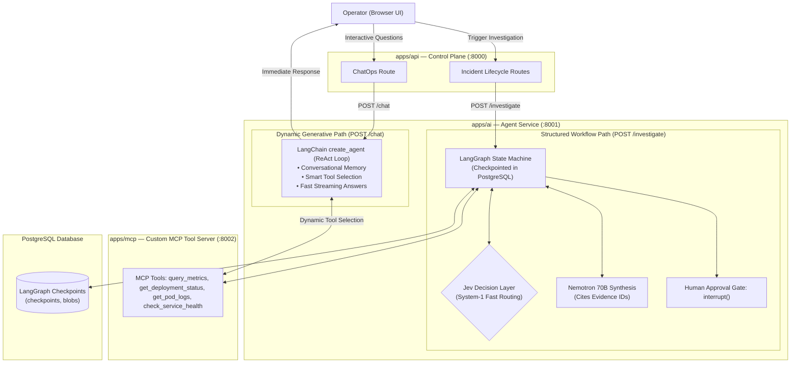

# FixProof — AI Agent Architecture (`apps/ai`)

> **Location:** `apps/ai/`  
> **Framework:** FastAPI + LangGraph (Lifecycle Workflow) + LangChain `create_agent` (ChatOps & Dynamic Tools) + Jev (Fast Decisions) + NVIDIA Nemotron 70B (Nebius Token Factory)  
> **Persistence:** Durable PostgreSQL Checkpointing (`AsyncPostgresSaver`)  
> **Port:** `8001` (internal Docker network only)

---

## 1. The Core Architectural Philosophy: Right Tool for the Right Job

LangGraph is a low-level, stateful orchestration framework. Running a full graph for every simple query introduces unnecessary overhead and latency. 

Therefore, FixProof splits AI responsibilities strictly between **Structured Macro-Workflows** (LangGraph + Jev) and **Dynamic Generative Tasks** (LangChain `create_agent` + Nemotron):

| Need | Framework | Why? |
|---|---|---|
| **Multi-step Incident Lifecycle & Human Pause** | **LangGraph** | Requires durable execution, state checkpointing in PostgreSQL, and pausing for human approval (`interrupt()`). |
| **Calibrated Routing & Risk Scoring** | **Jev (TypeSafe AI)** | Evaluates typed questions (`Choice`, `Score`, `Noul`) in milliseconds. Zero text generation, zero parsing, zero LLM latency. |
| **Interactive ChatOps & Smart Tool Selection** | **LangChain `create_agent`** | Fluid, conversational ReAct loop. Decides dynamically which MCP tools to call based on operator questions, with conversation memory. |
| **Deep Causal Synthesis & Citations** | **NVIDIA Nemotron 70B** | Generates plain-English root cause explanations and correlates multi-source timestamps. |

---

## 2. System Topology & Request Routing



---

## 3. Workflow 1: The Structured Lifecycle (LangGraph + Jev)

### When is LangGraph Used?
**Only for `POST /investigate` and post-fix verification.**  
This is the formal SRE lifecycle that changes database state, binds SHA-256 hashes, and requires a durable human approval gate.

### Why LangGraph + Jev Here?
1. **Durable Pause (`interrupt()`):** The operator may take minutes or hours to review the proposal. LangGraph commits state to PostgreSQL and sleeps. When the operator clicks "Approve", the graph wakes up from Postgres.
2. **Deterministic Branches via Jev:** We do not waste 4 seconds asking a 70B LLM "should I fetch logs?". Jev answers in milliseconds:
   - `Jev Noul`: *"Does the current telemetry clearly confirm an active fault?"* $\to$ `True/False`.
   - `Jev Score`: *"What is the blast radius risk of the proposed restore?"* $\to$ `LOW`, `MEDIUM`, `HIGH`.
3. **Pydantic Citation Guard:** Programmatic verification ensuring all hypotheses cite stored `EVD-...` evidence IDs before formatting the proposal.

### LangGraph Implementation Skeleton (`apps/ai/app/graph/workflow.py`)
```python
from langgraph.graph import StateGraph, END
from langgraph.types import interrupt
from langgraph.checkpoint.postgres.aio import AsyncPostgresSaver

class IncidentState(TypedDict):
    incident_id: str
    target_id: str
    symptom: str
    evidence_items: list[dict]
    is_sufficient: bool
    hypotheses: list[dict]
    risk_level: str
    recommendation: dict
    status: str

# 1. Gather Telemetry Node (calls MCP)
async def gather_telemetry_node(state: IncidentState):
    # Calls MCP query_metrics, get_deployment_status, check_service_health
    return state

# 2. Jev Sufficiency Node (System 1 - Official TypeSafe Jev API: POST /v1/systemone)
async def jev_sufficiency_node(state: IncidentState):
    # Official Jev request: turns state + typed questions into calibrated decisions
    eval_result = await jev.evaluate_sufficiency(evidence=state["evidence_items"])
    state["is_sufficient"] = eval_result.is_sufficient
    return state

# 3. LangGraph Conditional Router (using Jev's output)
def route_after_telemetry(state: IncidentState):
    if state["is_sufficient"]:
        return "nemotron_reasoning"
    return "fetch_additional_logs"

# 4. Nemotron Reasoning Node (System 2 - Deep Causal Synthesis)
async def nemotron_reasoning_node(state: IncidentState):
    # Prompts Nemotron 70B with evidence bundle; outputs structured hypotheses + citations
    return state

# 5. Jev Risk Scoring Node (System 1 - Official Jev Choice/Noul Decision)
async def jev_risk_node(state: IncidentState):
    risk_eval = await jev.score_remediation_risk(
        action=state["recommendation"],
        evidence=state["evidence_items"]
    )
    state["risk_level"] = risk_eval.risk_tier
    return state

# 6. Human Approval Pause (HITL Interrupt)
def human_approval_pause(state: IncidentState):
    decision = interrupt({
        "proposal": state["recommendation"],
        "risk_level": state["risk_level"]
    })
    state["status"] = decision.get("status", "rejected")
    return state
```

---

## 4. Workflow 2: Dynamic ChatOps & Tool Selection (LangChain `create_agent`)

### When is LangChain `create_agent` Used?
**Only for `POST /chat` (Interactive Operator Q&A).**

### Why LangChain `create_agent` Here?
- The operator wants to chat with the incident assistant in the web sidebar:
  - *"Why did you conclude FAIL_MODE was the cause?"*
  - *"Did pod-2 experience memory pressure?"*
  - *"Check the Prometheus 5xx graph for the last 15 minutes."*
- **You do NOT want LangGraph for this.** You want a fast, fluid, standard ReAct agent loop.
- LangChain's `create_agent` (or `create_react_agent`) is purpose-built for:
  1. Inspecting the question and conversation history.
  2. Dynamically picking the right MCP tool (`get_pod_logs` vs `query_metrics`).
  3. Formatting the arguments and executing the tool call.
  4. Streaming the natural language answer back to the operator in real time.

### LangChain ChatOps Implementation (`apps/ai/app/chat/agent.py`)
```python
from langchain.agents import create_react_agent, AgentExecutor
from langchain_openai import ChatOpenAI
from langchain_core.prompts import ChatPromptTemplate, MessagesPlaceholder
from app.mcp_client.tools import mcp_langchain_tools

def get_chatops_agent():
    # 1. Connect to Nebius Nemotron 70B
    llm = ChatOpenAI(
        base_url="https://api.tokenfactory.nebius.com/v1",
        api_key=settings.NEBIUS_API_KEY,
        model="nvidia/llama-3.1-nemotron-70b-instruct",
        temperature=0.2,
        streaming=True
    )
    
    # 2. Expose read-only MCP tools to the agent
    # Tools: [query_metrics, get_pod_logs, get_deployment_status, check_service_health]
    tools = mcp_langchain_tools
    
    # 3. Conversational ReAct Prompt
    prompt = ChatPromptTemplate.from_messages([
        ("system", "You are the FixProof SRE Assistant. Help the operator understand incident telemetry. "
                   "Use your tools to inspect live logs and metrics when asked. Never guess."),
        MessagesPlaceholder(variable_name="chat_history"),
        ("human", "{input}"),
        MessagesPlaceholder(variable_name="agent_scratchpad"),
    ])
    
    # 4. Create standard ReAct agent
    agent = create_react_agent(llm, tools, prompt)
    return AgentExecutor(agent=agent, tools=tools, verbose=True)
```

---

## 5. Summary of Framework Boundaries

| Capability | Framework | Execution Latency | State Persistence |
|---|---|---|---|
| **Incident Triage & Graph Routing** | **Jev** (`Choice`, `Noul`) | **~50 ms** | Stateless / In-memory evaluation |
| **Remediation Risk Rubric** | **Jev** (`Score`) | **~60 ms** | Stateless / In-memory evaluation |
| **Investigation Macro-Pipeline** | **LangGraph** | **~4–6 s** | **Durable PostgreSQL Checkpoint** (`AsyncPostgresSaver`) |
| **Human Approval Interrupt** | **LangGraph** (`interrupt()`) | **Indefinite (Sleeps)** | **Durable PostgreSQL Checkpoint** |
| **Operator Chat & Tool Execution** | **LangChain** (`create_agent`) | **~1–2 s (Streaming)** | In-memory session window / Redis |
| **Causal Reasoning & Citations** | **Nemotron 70B** (Nebius) | **~3–5 s** | Serialized into Proposal JSON |
| **Telemetry & Actions** | **Custom MCP Server** | **~10–50 ms** | Standardized Tool Protocol |

---

## 6. Directory Structure for `apps/ai`

```text
apps/ai/
├── Dockerfile
├── pyproject.toml
├── app/
│   ├── main.py                  # FastAPI server with /investigate and /chat routes
│   ├── config.py                # Environment secrets (NEBIUS_API_KEY, JEV_API_KEY, DB_URL)
│   │
│   ├── graph/                   # LANGGRAPH (Structured Lifecycle Workflow)
│   │   ├── state.py             # InvestigationState schema
│   │   ├── nodes.py             # Telemetry, Nemotron reasoning, Citation guard
│   │   ├── routing.py           # Jev conditional branching logic
│   │   └── workflow.py          # StateGraph definition with PostgreSQL checkpointer
│   │
│   ├── chat/                    # LANGCHAIN (Interactive ChatOps & Dynamic Tools)
│   │   ├── agent.py             # create_react_agent with conversation memory
│   │   └── prompts.py           # SRE assistant prompt templates
│   │
│   ├── decisions/               # JEV (System-1 Decision Engine)
│   │   └── jev_client.py        # Typed wrappers for Noul, Choice, and Score
│   │
│   └── mcp_client/              # TOOL CLIENT
│       ├── client.py            # HTTP/SSE client connecting to apps/mcp
│       └── tools.py             # LangChain tool wrappers for MCP endpoints
│
└── tests/
    ├── test_graph_lifecycle.py  # Tests LangGraph pipeline and interrupt()
    └── test_chat_agent.py       # Tests LangChain agent tool selection
```
