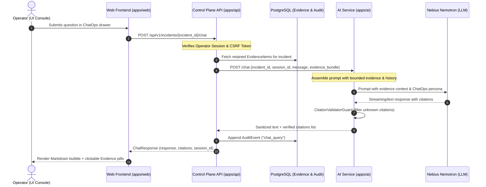

# ChatOps & Interactive Investigation Layer Architecture

## 1. Overview and Problem Statement

The FixProof agent architecture operates primarily on an **asynchronous, evidence-grounded diagnosis loop** (intake → durable worker → MCP tool execution → Nebius/Nemotron structured analysis → immutable proposal generation).

While this automated pipeline handles incident intake and proposal formulation, human operators often need to interactively interrogate an incident:
- *"What do the pod logs show right before the 5xx spike?"*
- *"Why did the model reject a database outage hypothesis?"*
- *"Are there any contradictions between the Prometheus scrape and direct probe metrics?"*

The **ChatOps layer** enables conversational interrogation of an incident without compromising the strict fail-closed safety boundary of FixProof.

---

## 2. Core Architectural Principles

1. **Strict Evidence Grounding (No Invented Facts)**
   - The ChatOps agent does not query the open internet or invent synthetic cluster state.
   - It is strictly bounded to the **retained evidence bundle** (`evidence_items` table) collected for the target incident.
   - Citations must match verified canonical UUIDs in the database (`[evidence-<uuid>]`).

2. **Zero Mutation Authority (Read-Only / Advisory)**
   - The chat interface is strictly **advisory**.
   - It cannot approve recommendations, mint execution capability tokens, or issue Kubernetes patches.
   - Proposals and executions remain strictly bound to the authenticated operator approval screen.

3. **Stateless Memory + Incident-Scoped History**
   - Each query is scoped to an `(incident_id, session_id)` tuple.
   - Conversation history is retained in a bounded sliding window (last 20 turns) to prevent context exhaustion and hallucination drift.
   - Citations returned in the conversation are validated via `CitationValidatorGuard` against the incident's persisted evidence.

---

## 3. Component Architecture & Data Flow



---

## 4. API & Schema Contract

### 4.1. API Layer (`apps/api`)
- **Route**: `POST /api/v1/incidents/{incident_id}/chat`
- **Authentication**: Required operator session cookie (`fixproof_session`) + CSRF token header (`X-CSRF-Token`).
- **Request Body**:
  ```json
  {
    "message": "Why is the service reporting 5xx errors?",
    "session_id": "operator-session-uuid"
  }
  ```
- **Response Shape**:
  ```json
  {
    "incident_id": "c04934a2-73f9-4191-ac9d-8437781d78c2",
    "response": "The `/healthz` probe failed with HTTP 500 while process readiness (`/readyz`) remained 200 [evidence-8bb3c47f-ebc4-441c-88be-f0e37a082f8f].",
    "citations": ["8bb3c47f-ebc4-441c-88be-f0e37a082f8f"],
    "session_id": "operator-session-uuid"
  }
  ```

### 4.2. AI Service Layer (`apps/ai`)
- **Route**: `POST /chat`
- **Security**: Service-to-service header `Authorization: Bearer <SERVICE_AUTH_TOKEN>`.
- **Payload**:
  ```python
  class ChatRequest(BaseModel):
      incident_id: str
      investigation_id: str | None = None
      session_id: str
      message: str
      evidence: list[EvidenceReference] = []
  ```

---

## 5. UI / UX Specification

The frontend integration lives directly within the **Incident Details & Investigation** workspace:

1. **Collapsible ChatOps Drawer**:
   - Anchored as an interactive drawer or split panel on `/incidents/:incidentId`.
   - Distinct AI vs. Operator chat bubbles.
   - Typing indicator and retry controls on network/provider timeout.

2. **Interactive Evidence Pills**:
   - Citations returned in the message (e.g. `[evidence-3d671465...]`) are rendered as interactive pills.
   - Clicking a citation pill highlights and scrolls directly to the corresponding source card in the **Source Observations** timeline.

3. **Suggested Incident Prompts**:
   - *"Summarize the current hypotheses"*
   - *"What are the Prometheus error rate readings?"*
   - *"Did the functional health probe fail?"*

---

## 6. Security & Audit Guardrails

- **Prompt Injection Defense**: Logs and raw telemetry strings inside the evidence bundle are wrapped in untrusted data delimiters.
- **Audit Logging**: Every chat query and response is recorded in the append-only `audit_events` table under action `chat_query`, ensuring full compliance and operator accountability.
- **Fail-Closed Fallback**: If Nebius or the inference provider is unreachable or returns malformed text, the chat responds with a clean advisory notice: *"Model analysis is temporarily unavailable. Review the retained source observations directly."*

