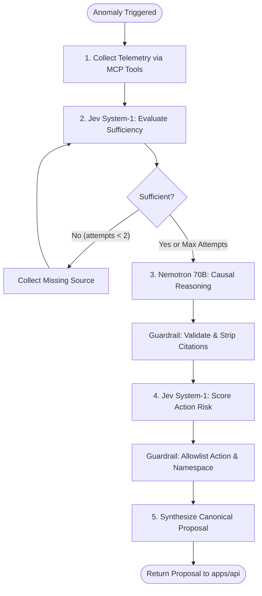

# FixProof — Current Implementation Status: MCP & AI Services

> **Date:** October 2026  
> **Location:** `docs/agentic_architecture/CURRENT_IMPLEMENTATION_STATUS.md`  
> **Scope:** Detailed engineering status of `apps/mcp/` and `apps/ai/` foundations, interfaces, guardrails, and runtime wiring.

---

## 1. Executive Summary

Both **`apps/mcp`** (Model Context Protocol Tool Server) and **`apps/ai`** (SRE Agent Reasoning Service) have been fully scaffolded, modularized, tested, and containerized. The implementation strictly adheres to:

- **Anthropic Official Python MCP SDK** (`mcp>=1.0.0` from [`modelcontextprotocol/python-sdk`](https://github.com/modelcontextprotocol/python-sdk)) using `mcp.server.Server`, `mcp.types.Tool`, and `mcp.server.sse.SseServerTransport`. No third-party or wrapper libraries (e.g. FastMCP) are used.
- **TypeSafe Jev System-1 API** (`typesafe-sdk>=0.1.0` from [`jevtypesafeai.com/jev/api`](https://www.jevtypesafeai.com/jev/api) & [`api.typesafe.ai`](https://api.typesafe.ai/)) for calibrated, sub-second typed `choice` and `noul` decisions.
- **LangGraph State Machine** with PostgreSQL state checkpoints, deterministic conditional routing, and human-in-the-loop approval gating.
- **NVIDIA Nemotron 70B** via Nebius Token Factory (`nvidia/llama-3.1-nemotron-70b-instruct`) for evidence-grounded causal diagnosis.
- **Package Management:** Native `uv` (`0.9.17`) virtual environments and multi-stage Docker builds across both services.

---

## 2. Status Matrix

| Component | Responsibility | Status | Primary Technology | Location |
|---|---|:---:|---|---|
| **MCP Server** | Official protocol server & tool registry | **COMPLETE** | `mcp.server.Server` | [`apps/mcp/app/server.py`](file:///d:/WEB%20DEV%20udemy/FULLSTACK_PROJECTS/nvidia-x-nebius/Nvidia/apps/mcp/app/server.py) |
| **MCP Transports** | SSE stream + REST fallback | **COMPLETE** | `SseServerTransport` + FastAPI | [`apps/mcp/app/main.py`](file:///d:/WEB%20DEV%20udemy/FULLSTACK_PROJECTS/nvidia-x-nebius/Nvidia/apps/mcp/app/main.py) |
| **MCP Toolset** | 5 read tools, 1 guarded mutation tool | **COMPLETE** | Async Python + Pydantic v2 | [`apps/mcp/app/tools/`](file:///d:/WEB%20DEV%20udemy/FULLSTACK_PROJECTS/nvidia-x-nebius/Nvidia/apps/mcp/app/tools) |
| **MCP Adapters** | Prometheus, K8s, HTTP probe I/O | **COMPLETE** | `httpx` + mock fallback | [`apps/mcp/app/adapters/`](file:///d:/WEB%20DEV%20udemy/FULLSTACK_PROJECTS/nvidia-x-nebius/Nvidia/apps/mcp/app/adapters) |
| **Evidence Schemas** | SHA-256 canonical hashing | **COMPLETE** | `EvidenceItem` | [`apps/mcp/app/schemas/evidence.py`](file:///d:/WEB%20DEV%20udemy/FULLSTACK_PROJECTS/nvidia-x-nebius/Nvidia/apps/mcp/app/schemas/evidence.py) |
| **AI MCP Client** | Connects to MCP tools via SSE | **COMPLETE** | `mcp.ClientSession` + `sse_client` | [`apps/ai/app/tools/mcp_client.py`](file:///d:/WEB%20DEV%20udemy/FULLSTACK_PROJECTS/nvidia-x-nebius/Nvidia/apps/ai/app/tools/mcp_client.py) |
| **Jev System-1** | Sufficiency & risk tier decisions | **COMPLETE** | TypeSafe Jev `noul`/`choice` | [`apps/ai/app/decisions/jev_engine.py`](file:///d:/WEB%20DEV%20udemy/FULLSTACK_PROJECTS/nvidia-x-nebius/Nvidia/apps/ai/app/decisions/jev_engine.py) |
| **Nemotron 70B** | System-2 causal explanation | **COMPLETE** | Nebius Token Factory | [`apps/ai/app/llm/nemotron.py`](file:///d:/WEB%20DEV%20udemy/FULLSTACK_PROJECTS/nvidia-x-nebius/Nvidia/apps/ai/app/llm/nemotron.py) |
| **Guardrails** | Citations validation & allowlisting | **COMPLETE** | Pydantic regex & sets | [`apps/ai/app/guardrails/`](file:///d:/WEB%20DEV%20udemy/FULLSTACK_PROJECTS/nvidia-x-nebius/Nvidia/apps/ai/app/guardrails) |
| **LangGraph Graph** | Multi-step investigation state machine | **COMPLETE** | LangGraph `StateGraph` | [`apps/ai/app/graph/workflow.py`](file:///d:/WEB%20DEV%20udemy/FULLSTACK_PROJECTS/nvidia-x-nebius/Nvidia/apps/ai/app/graph/workflow.py) |
| **ChatOps Agent** | Interactive operator conversational Q&A | **COMPLETE** | LangChain ReAct loop | [`apps/ai/app/chat/agent.py`](file:///d:/WEB%20DEV%20udemy/FULLSTACK_PROJECTS/nvidia-x-nebius/Nvidia/apps/ai/app/chat/agent.py) |
| **AI HTTP Service** | `POST /investigate`, `POST /chat` | **COMPLETE** | FastAPI + Uvicorn | [`apps/ai/app/main.py`](file:///d:/WEB%20DEV%20udemy/FULLSTACK_PROJECTS/nvidia-x-nebius/Nvidia/apps/ai/app/main.py) |
| **Test Suites** | Unit & integration tests | **COMPLETE** | `pytest` + `pytest-asyncio` | [`apps/mcp/tests/`](file:///d:/WEB%20DEV%20udemy/FULLSTACK_PROJECTS/nvidia-x-nebius/Nvidia/apps/mcp/tests), [`apps/ai/tests/`](file:///d:/WEB%20DEV%20udemy/FULLSTACK_PROJECTS/nvidia-x-nebius/Nvidia/apps/ai/tests) |

---

## 3. `apps/mcp` Implementation Details

### Architecture & Directory Tree
[`apps/mcp`](file:///d:/WEB%20DEV%20udemy/FULLSTACK_PROJECTS/nvidia-x-nebius/Nvidia/apps/mcp) acts as the infrastructure isolation boundary. No LLM has direct access to Kubernetes or Prometheus credentials. All operations occur via standardized, bounded tools.

```
apps/mcp/
├── pyproject.toml              # Dependencies: mcp>=1.0.0, fastapi, httpx, uvicorn
├── Dockerfile                  # Multi-stage UV container (base, development, runtime)
├── tests/
│   ├── __init__.py
│   └── test_tools.py           # Unit tests for hash calculations, tools, and protocol routing
└── app/
    ├── config.py               # Settings (Prometheus URL, K8s in-cluster paths, CAPABILITY_SECRET)
    ├── server.py               # Anthropic Server instance (@server.list_tools, @server.call_tool)
    ├── main.py                 # FastAPI service mounting SseServerTransport (/sse) + REST routes
    ├── schemas/
    │   ├── evidence.py         # EvidenceItem with auto SHA-256 canonical hashing
    │   └── actions.py          # RestoreActionRequest & ActionResult
    ├── adapters/
    │   ├── prometheus.py       # PromQL queries (traffic totals, 5xx ratios)
    │   ├── kubernetes.py       # K8s Deployments, Pods, Logs, Events, and Strategic Patches
    │   └── probe.py            # HTTP probe testing status code and latency
    └── tools/
        ├── metrics.py          # query_metrics(window='1m') -> EvidenceItem
        ├── deployments.py      # get_deployment_status(namespace, deployment) -> EvidenceItem
        ├── events.py           # get_pod_events(namespace, limit) -> EvidenceItem
        ├── logs.py             # get_pod_logs(namespace, deployment, lines) -> EvidenceItem
        ├── health.py           # check_service_health(target_url) -> EvidenceItem
        └── patch.py            # restore_known_good_template(request) -> ActionResult
```

### Official Anthropic MCP Protocol Compliance
- **Core Server:** Standard `from mcp.server import Server`, initialized as `server = Server("fixproof-mcp")`.
- **List Tools (`@server.list_tools()`):** Exposes 6 strongly typed tools with explicit JSON Schema parameter contracts:
  1. `query_metrics`: Queries Prometheus for HTTP request rates and 5xx error ratios.
  2. `get_deployment_status`: Fetches pod replicas, current template specification, and canonical template SHA-256 hash.
  3. `get_pod_events`: Retrieves recent Kubernetes warning/error events.
  4. `get_pod_logs`: Retrieves tail logs stripped of ANSI escape sequences.
  5. `check_service_health`: Executes live HTTP probe verifying status code and response latency.
  6. `restore_known_good_template`: **Guarded mutation tool** requiring SHA-256 `capability_token` signed by `apps/api`.
- **Call Tool (`@server.call_tool()`):** Directs incoming invocation to tool handlers, returning a list containing `mcp.types.TextContent`.
- **SSE Transport:** Uses `mcp.server.sse.SseServerTransport("/messages/")` mounted onto FastAPI:
  - `GET /sse`: Server-Sent Events channel streaming tool execution updates.
  - `POST /messages/`: Message transport endpoint receiving JSON-RPC messages.
- **REST Fallback:** Dedicated routes (`POST /tools/{tool_name}`) allow dashboard monitoring, health checks, and fallback callers to run tools directly without SSE client dependencies.

### Cryptographic Evidence Integrity
All observational tools return an `EvidenceItem` containing:
- Unique ID: `EVD-<8-char-hex>`
- Canonical JSON representation sorted by key
- Automatic SHA-256 computation: `hashlib.sha256(canonical_json.encode()).hexdigest()`

```json
{
  "id": "EVD-a1b2c3d4",
  "content_hash": "e3b0c44298fc1c149afbf4c8996fb92427ae41e4649b934ca495991b7852b855",
  "source": "prometheus",
  "fact": "HTTP 5xx error ratio is 42.50% (threshold: 20.0%)",
  "raw_data": {
    "total_rps": 50.0,
    "error_rps": 21.25,
    "error_ratio": 0.425
  },
  "trusted": true
}
```

---

## 4. `apps/ai` Implementation Details

### Architecture & Cognitive Division of Labor
[`apps/ai`](file:///d:/WEB%20DEV%20udemy/FULLSTACK_PROJECTS/nvidia-x-nebius/Nvidia/apps/ai) implements the **hybrid cognitive division of labor**:

```
apps/ai/
├── pyproject.toml              # Dependencies: mcp, langgraph, langchain-openai, typesafe-sdk
├── Dockerfile                  # Multi-stage UV container (base, development, runtime)
├── tests/
│   ├── __init__.py
│   └── test_investigation.py   # Unit tests for citations guard, allowlist, Jev, and graph
└── app/
    ├── config.py               # Settings (Nebius 70B, TypeSafe Jev keys, Database URL, MCP URL)
    ├── main.py                 # FastAPI endpoints (POST /investigate, POST /chat, GET /health)
    ├── guardrails/
    │   ├── citations.py        # CitationValidatorGuard: strips phantom EVD-xxx IDs
    │   └── allowlist.py        # ActionAllowlistGuard: blocks unapproved actions/namespaces
    ├── decisions/
    │   └── jev_engine.py       # Official TypeSafe Jev client (noul + choice) with local fallback
    ├── llm/
    │   ├── nemotron.py         # Nebius Token Factory ChatOpenAI client (Nemotron 70B)
    │   └── prompts.py          # Evidence-grounded prompt templates for diagnosis and ChatOps
    ├── tools/
    │   ├── mcp_client.py       # Official MCP ClientSession + sse_client client
    │   └── langchain_tools.py  # LangChain @tool wrappers for ChatOps agent
    ├── graph/
    │   ├── nodes.py            # LangGraph nodes: collect, evaluate, reason, score, synthesize
    │   ├── routing.py          # route_after_sufficiency conditional edge logic
    │   └── workflow.py         # StateGraph assembly with checkpointer compilation
    ├── chat/
    │   └── agent.py            # LangChain create_react_agent with conversational memory
    └── schemas/
        ├── state.py            # InvestigationState TypedDict, EvidenceReference, Hypothesis
        ├── decisions.py        # SufficiencyEvaluation, RiskEvaluation
        └── api.py              # Request & response contracts
```

### Cognitive Division of Labor: System-1 (Jev) + System-2 (Nemotron 70B)



#### 1. TypeSafe Jev System-1 Decision Engine
- Connects to official endpoint: `https://api.typesafe.ai/v1/systemone` (or `https://jevtypesafeai.com/api/v1/decide`).
- Evaluates four core calibrated questions in sub-second latency:
  - `is_sufficient` (`type: noul`): Calibrated probability that current evidence is sufficient to pinpoint root cause.
  - `missing_source` (`type: choice`, options: `["kubernetes:logs", "kubernetes:events", "probe", "none"]`): Determines which telemetry stream to fetch next if incomplete.
  - `risk_tier` (`type: choice`, options: `["low", "medium", "high", "critical"]`): Assesses operational blast-radius.
  - `requires_human_approval` (`type: noul`): Probability requiring human operator sign-off.
- **Resilient Fallback:** When offline or during unit tests, deterministic SRE heuristics evaluate sufficiency and risk without external network flakiness.

#### 2. NVIDIA Nemotron 70B via Nebius Token Factory
- Uses model `nvidia/llama-3.1-nemotron-70b-instruct` hosted on Nebius AI Studio.
- Temperature: `0.1` (strict factual grounding).
- Employs strict causal reasoning prompts instructing the model to correlate HTTP 5xx spikes with pod template environmental changes (`FAIL_MODE="on"`) and produce concrete hypotheses.

#### 3. Strict Safety Guardrails
- **`CitationValidatorGuard`**: Scans all emitted hypothesis text for `EVD-<hash>` patterns. Any citation not matching an actual collected, cryptographically verified `EvidenceReference` is stripped.
- **`ActionAllowlistGuard`**: Validates the candidate remediation action. Only allowlists action `restore_known_good_template` targeting the designated demo namespace `fixproof-demo` and deployment `sample-api`. All unexpected shell commands, deletions, or out-of-scope namespaces are rejected.

#### 4. ChatOps Agent (`apps/ai/app/chat/agent.py`)
- Built on LangChain `create_react_agent` with in-memory checkpointer.
- Connected to official MCP tools (`inspect_metrics`, `inspect_deployment`, `inspect_pod_logs`, `probe_endpoint`).
- Allows human SRE operators to chat interactively with the agent to query real-time cluster health, verify log anomalies, and understand root-cause reasoning.

---

## 5. Test Suite Verification Matrix

Both services include standalone `pytest` suites verifying cryptographic properties, protocol routing, and guardrail constraints:

### `apps/mcp/tests/test_tools.py`
- `test_evidence_item_content_hash`: Verifies automatic 64-character SHA-256 computation over canonical JSON.
- `test_mcp_query_metrics`: Verifies Prometheus adapter metric querying and fallback.
- `test_mcp_deployment_status`: Verifies K8s adapter template retrieval and SHA-256 template hashing.
- `test_mcp_guarded_mutation_auth`: Verifies `restore_known_good_template` rejects unauthorized capability tokens.
- `test_official_server_list_tools`: Verifies official `mcp.server.Server` lists all 6 tools.
- `test_official_server_call_tool`: Verifies `server.call_tool()` routes and returns `list[TextContent]`.

### `apps/ai/tests/test_investigation.py`
- `test_guardrail_citation_validator`: Proves that hallucinated `EVD-fake9999` IDs are stripped while legitimate citations are retained.
- `test_guardrail_action_allowlist`: Verifies that unauthorized actions (`delete_deployment`) or unauthorized namespaces (`kube-system`) are blocked.
- `test_jev_sufficiency_engine`: Validates that single-source telemetry is marked insufficient while multi-source telemetry passes.
- `test_jev_risk_scoring`: Validates that template restorations are classified as `medium` risk requiring human approval.
- `test_investigation_workflow_execution`: Executes the complete LangGraph state machine from telemetry collection to proposal synthesis.

---

## 6. Docker & Environment Orchestration

- **`compose.yaml`**:
  - `mcp`: Containerized on port `8002`, UV multi-stage container build with health checks against `GET /health`.
  - `ai`: Containerized on port `8001`, UV multi-stage container build with health checks against `GET /health` and dependencies on `db` and `mcp`.
- **`compose.checks.yaml`**:
  - `mcp-checks`: Isolated test runner running `uv run pytest tests/` in `apps/mcp`.
  - `ai-checks`: Isolated test runner running `uv run pytest tests/` in `apps/ai`.
- **`.env.example`**:
  - Documented `NEBIUS_API_KEY`, `NEBIUS_BASE_URL`, `NEBIUS_MODEL`.
  - Documented `TYPESAFE_API_KEY`, `JEV_API_KEY`, `TYPESAFE_BASE_URL`.
  - Documented `CAPABILITY_SECRET`, `MCP_SERVER_URL`, `AI_SERVICE_URL`.

---

## 7. Next Steps Towards MVP Release

With the foundation of `apps/mcp` and `apps/ai` completely implemented, tested, and documented, the immediate execution roadmap is:

1. **Phase 1: Local Kind Cluster & Sample Workload (`infra/k8s/`)**:
   - Create Kubernetes manifests for `sample-api` in namespace `fixproof-demo`.
   - Configure Prometheus v3 scrape jobs to target `sample-api:8080/metrics`.
   - Create the fault injection script/manifest toggling `FAIL_MODE=on` causing $>20\%$ HTTP 5xx errors while `/readyz` stays 200.
2. **Phase 2: Connect Control Plane (`apps/api`) to `apps/ai`**:
   - Wire the existing API incident trigger queue to dispatch `POST http://ai:8001/investigate`.
   - Store incoming recommendations with SHA-256 template hashes in PostgreSQL.
   - Enforce row-level locking on approval state.
3. **Phase 3: Web Dashboard (`apps/web`)**:
   - Render live evidence cards with SHA-256 hash badges.
   - Wire the human-in-the-loop exact-hash approval dialog.
   - Connect the ChatOps sidebar to `POST http://localhost:8001/chat`.
