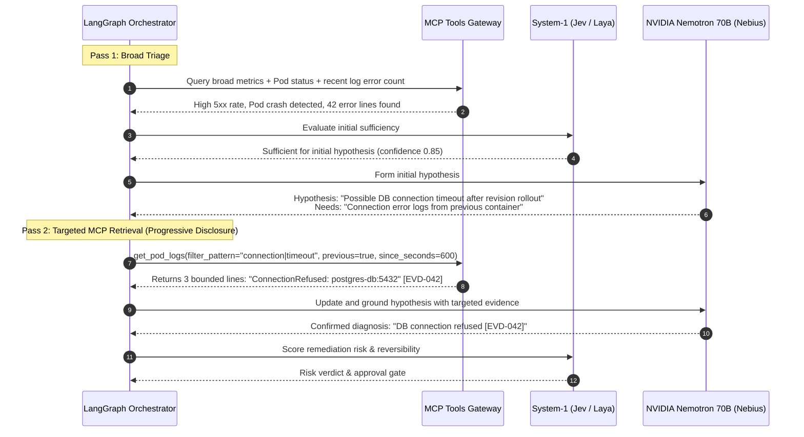

# FixProof: Iterative Retrieval & Context Engineering Strategy

**Document Owner**: Architecture & Engineering Team  
**Purpose**: Implementation blueprint to upgrade FixProof's investigation pipeline from a static one-shot retrieval model to an iterative, hypothesis-driven retrieval architecture based on LangChain Context Engineering principles.  
**Reference Reading**: [LangChain Context Engineering for Agents](https://www.langchain.com/blog/context-engineering-for-agents)

---

## 1. Problem Statement: Why Static One-Shot Retrieval Breaks

Currently, FixProof executes a single forward pass:
```
collect_telemetry (fixed 5 sources) -> evaluate_sufficiency (Jev/Laya) -> reason_causes (Nemotron 70B runs once) -> score_risk -> END
```

### The Limitations
1. **The Recency Trap**: `tailLines=100` retrieves only the newest 100 log lines. If a crash or database disconnection occurred 5 minutes ago and the container logged 150 periodic `/healthz` checks since, the true root cause has been pushed out of the window.
2. **Information-Loss Compression**: Counting lines with `500` or `ERROR` into `"Identified 42 lines indicating errors"` strips the actual error signature (`ConnectionRefused: db:5432` vs `JWTKeyMissing`).
3. **Zero Hypothesis Verification**: Once Nemotron forms a hypothesis, it cannot execute a targeted follow-up query to confirm or refute it. It must guess based solely on the initial 100-line sample.

---

## 2. Core Principles: LangChain Context Engineering

To scale log and telemetry analysis without inflating token costs or context latency, we apply LangChain's four context engineering pillars:

| Pillar | LangChain Principle | FixProof Application |
|---|---|---|
| **1. Context Offloading** | Keep bulky payloads out of working memory; store off-band and pass pointers. | Full raw log streams are retained in PostgreSQL/MCP storage. The LangGraph state holds only `EvidenceReference(id="EVD-...", content_hash="...")` pointers. |
| **2. Context Reduction** | Use reversible compaction (structured signatures) instead of lossy generic summarization. | Extract normalized error signatures (e.g. `ConnectionRefusedError: db:5432`), first/last timestamps, and 2–3 bounded representative lines instead of pure line counts. |
| **3. Context Isolation** | Isolate noisy tool outputs to dedicated subtasks/nodes. | Heavy regex/parsing runs inside MCP tools. Only clean, normalized evidence items enter the LangGraph context. |
| **4. Progressive Disclosure (Iterative Retrieval)** | Fetch high-level triage data first; retrieve targeted deep evidence only on demand. | Pass 1: Broad telemetry triage. Pass 2: Targeted query testing Nemotron's hypothesis within a strict investigation budget. |

---

## 3. Target Architecture: The Iterative Retrieval Loop



---

## 4. Implementation Specification for the Engineering Team

### Task 1: Enrich MCP Log Tool (`apps/mcp/app/tools/logs.py`)

Upgrade `get_pod_logs` to extract **structured signatures** and support **targeted querying**:

```python
# apps/mcp/app/tools/logs.py
from pydantic import BaseModel, Field

class PodLogsQuery(BaseModel):
    namespace: str = "fixproof-demo"
    deployment_name: str = "sample-api"
    lines: int = Field(default=50, ge=1, le=100)
    previous: bool = Field(default=False, description="Fetch terminated container logs if restarted")
    filter_pattern: str | None = Field(default=None, description="Regex or keyword to grep within logs")
    since_seconds: int | None = Field(default=None, description="Only fetch logs within past N seconds")

# Output signature extraction:
# Instead of returning just error counts, extract:
# 1. unique error signatures (normalized regex)
# 2. first_seen and last_seen timestamps
# 3. 2-3 bounded representative excerpt lines
```

### Task 2: Update LangGraph Investigation State (`apps/ai/app/schemas/state.py`)

Add budget management and query iteration tracking:

```python
# apps/ai/app/schemas/state.py
class InvestigationState(TypedDict):
    incident_id: str
    run_id: str
    namespace: str
    deployment_name: str
    
    # Context Offloading: Only store pointers & compact summaries in graph state
    evidence_refs: list[str]          # ['EVD-001', 'EVD-002']
    evidence: list[EvidenceReference] # Compact metadata + bounded facts
    
    # Iteration & Budget Management (LangChain Context Engineering)
    iteration_count: int              # Current query pass (e.g. 1, 2)
    max_budget: int                   # Max allowed passes (hardcoded to 2)
    targeted_query_needed: bool       # Does Nemotron request follow-up evidence?
    targeted_query_spec: dict[str, Any] | None # Parameters for follow-up query
    
    # Reasoning state
    hypotheses: list[Hypothesis]
    root_cause_summary: str | None
    investigation_status: str
```

### Task 3: Close the Graph Loop (`apps/ai/app/graph/workflow.py`)

Add a conditional cycle between `reason_causes` and `targeted_retrieval`:

```python
# apps/ai/app/graph/workflow.py
def route_after_reasoning(state: InvestigationState) -> str:
    """Check if model needs follow-up evidence and budget remains."""
    if state.get("targeted_query_needed") and state.get("iteration_count", 0) < state.get("max_budget", 2):
        return "targeted_retrieval"
    return "score_risk"

# Wire conditional edges:
builder.add_node("targeted_retrieval", targeted_retrieval_node)
builder.add_conditional_edges("reason_causes", route_after_reasoning, {
    "targeted_retrieval": "targeted_retrieval",
    "score_risk": "score_risk",
})
builder.add_edge("targeted_retrieval", "reason_causes")
```

### Task 4: Defensive Bounding Rules

To preserve FixProof's safety invariants:
1. **Strict Hard Budget**: `max_budget` must never exceed **2 iterations** to avoid cost overruns or infinite loops.
2. **Context Compaction**: Representative log excerpts must not exceed **3 lines** and **200 characters per line**.
3. **Timestamp Separation**:
   - `collected_at`: FixProof fetch time (used for transport freshness check).
   - `event_time`: Time of the logged event (used for incident window correlation).
4. **Untrusted Input Marker**: Retain `trusted=False` on all log excerpts to prevent prompt injection.

---

## 5. Verification Checklist for PR

- [ ] `get_pod_logs` supports `previous=True` and `filter_pattern`.
- [ ] Error messages are grouped into normalized signatures (not just raw line counts).
- [ ] LangGraph terminates cleanly within 2 iterations.
- [ ] All hypotheses cite specific `[EVD-...]` IDs.
- [ ] Total prompt token count for Nemotron remains $<2{,}000$ tokens per pass.

