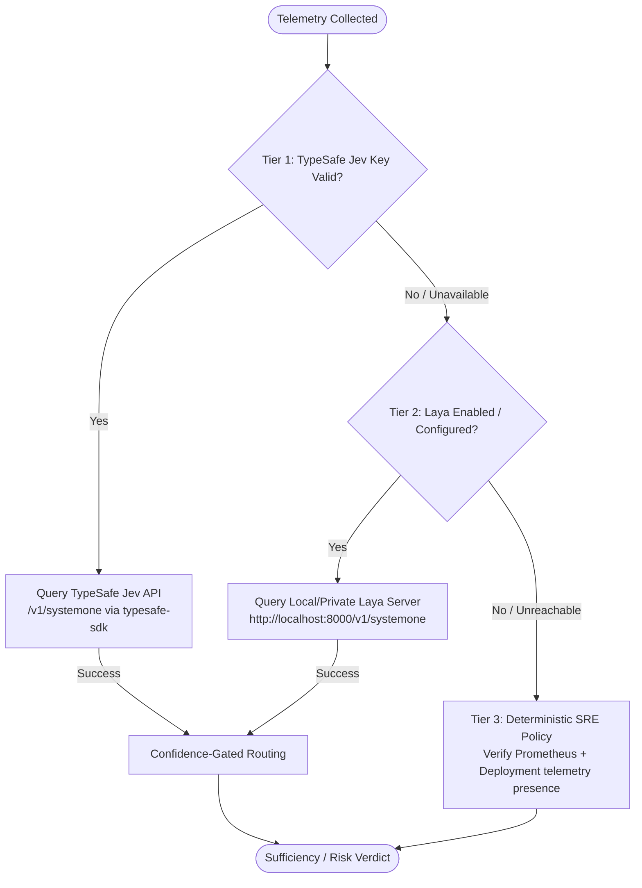
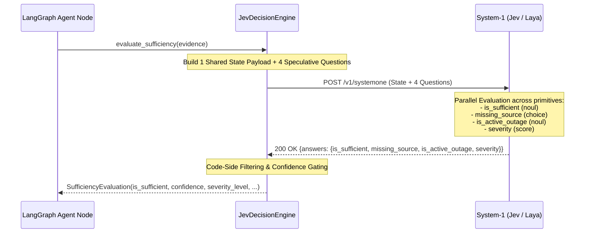

# Jev & Laya Decision Engine Implementation

**Status**: Active in `apps/ai/app/decisions/jev_engine.py`.  
**Architecture Context**: Pre-reasoning System-1 decision layer before heavy System-2 LLM inference (NVIDIA Nemotron via Nebius).

---

## 1. Overview and Problem Statement

In autonomous incident triage, querying a general-purpose Large Language Model (System-2) for every intermediate gating check introduces significant latency, high token costs, non-deterministic JSON parsing issues, and fragile retry loops.

FixProof uses a dual-engine architecture:
- **System-1 (Fast, Calibrated Decision Engine)**: Evaluates telemetry sufficiency and remediation risk in sub-second time using typed mathematical primitives (`Noul`, `Choice`, `Score`).
- **System-2 (Deep Causal Reasoning)**: NVIDIA Nemotron (via Nebius Token Factory) generates causal hypotheses and diagnostic summaries only after System-1 confirms telemetry sufficiency.

The decision engine is implemented in [`apps/ai/app/decisions/jev_engine.py`](file:///d:/WEB%20DEV%20udemy/FULLSTACK_PROJECTS/nvidia-x-nebius/Nvidia/apps/ai/app/decisions/jev_engine.py) under the single class name `JevDecisionEngine`.

---

## 2. Three-Tier Fallback Hierarchy

To ensure high availability, local offline development, and zero vendor lock-in, the engine operates on a three-tier fallback hierarchy:



1. **Tier 1 — TypeSafe Jev (Cloud System-1)**:
   - Primary cloud decision engine using TypeSafe AI models.
   - Invoked via the official `typesafe-sdk` client or direct HTTP POST to `https://api.typesafe.ai/v1/systemone`.
   - Activated when a live `JEV_API_KEY` (or `TYPESAFE_API_KEY`) is configured.

2. **Tier 2 — Laya (Open-Source System-1 Fallback)**:
   - When Jev credentials are mock, unset, or unreachable, the engine falls back to [Laya](https://laya-ai.com).
   - Laya provides an open-weights, self-hostable System-1 model designed to expose the exact same `/v1/systemone` HTTP protocol and typed question schemas.
   - Configured via `LAYA_ENABLED=true` and `LAYA_BASE_URL=http://localhost:8000`.

3. **Tier 3 — Deterministic SRE Policy (Offline Local Fallback)**:
   - If both external and local neural decision engines are offline (e.g. during offline unit tests or disconnected local development), the engine evaluates strict deterministic rules.
   - Fails closed unless core operational telemetry (`prometheus` metrics and `kubernetes:deployment` pod spec) is physically present in the evidence set.

---

## 3. Speculative Fan-Out Pattern

Based on the [TypeSafe Fan-Out Pattern](https://docs.typesafe.ai/patterns/fan-out), the engine avoids sequential request chaining.

### The Sequential LLM Problem
In traditional LLM agent architectures, decision flows require multiple sequential roundtrips:
1. *Request 1*: "Is this evidence sufficient?" $\rightarrow$ wait 1.5s $\rightarrow$ receive JSON.
2. *Request 2*: "What source is missing?" $\rightarrow$ wait 1.5s $\rightarrow$ receive JSON.
3. *Request 3*: "Is there an active outage?" $\rightarrow$ wait 1.5s $\rightarrow$ receive JSON.
4. *Request 4*: "What is the severity?" $\rightarrow$ wait 1.5s $\rightarrow$ receive JSON.

Total roundtrip time: **6+ seconds** with 4 separate token payloads sent over the wire.

### The TypeSafe Speculative Fan-Out Solution
Because System-1 models evaluate inputs in parallel in hundreds of milliseconds, speculative questions incur virtually **zero marginal latency**. The full incident telemetry state is sent **once**, paired with multiple speculative questions evaluated simultaneously in a single pass:



---

## 4. Question Schemas in FixProof

### 4.1 Sufficiency Evaluation Fan-Out (`evaluate_sufficiency`)

Sent concurrently against `Incident Telemetry State: [...]`:

| Question Key | Primitive Type | Instructions / Criteria | Purpose |
|---|---|---|---|
| `is_sufficient` | `noul` | Is the accumulated telemetry evidence sufficient to isolate root cause without ambiguity? | Core sufficiency probability ($0.0 \dots 1.0$) |
| `missing_source` | `choice` | Criteria: `none`, `prometheus`, `kubernetes_deployment`, `kubernetes_logs`, `direct_probe` | Immediate diagnostic gap identification |
| `is_active_outage` | `noul` | Does the observed telemetry confirm customer-facing traffic is actively failing or dropping? | Outage confirmation flag |
| `severity` | `score` | Scale / Criteria: `routine`, `degraded`, `severe`, `critical` | Triage severity tiering |

### 4.2 Remediation Risk Scoring Fan-Out (`score_remediation_risk`)

Sent concurrently when assessing an advisory remediation candidate (e.g. restoring known-good deployment template):

| Question Key | Primitive Type | Instructions / Criteria | Purpose |
|---|---|---|---|
| `risk_tier` | `choice` | Criteria: `low`, `medium`, `high`, `critical` | Operational blast radius |
| `requires_human_approval` | `noul` | Does this action require explicit human operator authorization? | Autonomy enforcement gate |
| `is_reversible` | `noul` | Can this action be rolled back cleanly without state loss? | Rollback safety assurance |

---

## 5. Confidence-Gated Routing

The output answers are processed using deterministic code-side filtering:

```python
# Extract typed outputs
noul_val = float(answers.get("is_sufficient", {}).get("noul", 0.0))
missing_choice = answers.get("missing_source", {}).get("choice", "none")
is_active_outage = bool(float(answers.get("is_active_outage", {}).get("noul", 0.9)) >= 0.5)
severity = answers.get("severity", {}).get("choice", "severe")

# Confidence Gate:
# Requires >= 0.70 confidence AND physical presence of core live telemetry
is_sufficient = (
    noul_val >= 0.70
    and {"prometheus", "kubernetes:deployment"} <= live_sources
)
```

- **Pass Gate**: If confidence $\ge 0.70$ and required telemetry is physically present $\rightarrow$ Investigation proceeds to System-2 LLM causal analysis.
- **Fail / Divert Gate**: If confidence $< 0.70$ or critical telemetry is absent $\rightarrow$ The collector node retries the specifically identified `missing_source`, or routes the incident to `needs_review` for operator triage.

---

## 6. Environment Configuration

In `.env`:

```bash
# Preferred System-1 Provider ('jev' or 'laya')
SYSTEM1_PROVIDER=laya

# Laya (Open Source Fallback)
LAYA_ENABLED=false             # Set to true when running local Laya server
LAYA_BASE_URL=http://localhost:8000
LAYA_API_KEY=                  # Optional bearer token

# TypeSafe Jev (Cloud System-1)
JEV_API_KEY=mock-jev-key       # Live key from typesafe.ai
JEV_BASE_URL=https://api.typesafe.ai
```

---

## 7. Testing & Verification

- **Mocked HTTP Transport**: In [`apps/ai/tests/test_laya.py`](file:///d:/WEB%20DEV%20udemy/FULLSTACK_PROJECTS/nvidia-x-nebius/Nvidia/apps/ai/tests/test_laya.py), tests use `httpx.MockTransport` to simulate Laya `/v1/systemone` responses without needing network access or running local GPU containers.
- **Offline Safety**: If `LAYA_ENABLED=false` and Jev key is mock, the engine immediately takes the deterministic SRE path without attempting outbound network connections or timing out.

