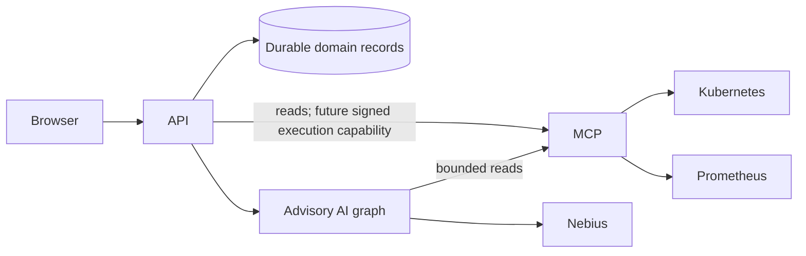

# Agentic architecture

FixProof has one API control plane, one advisory AI service, and one bounded MCP infrastructure gateway. This directory describes their contracts; it does not claim that the kind recovery workflow is implemented.

Read [current implementation status](CURRENT_IMPLEMENTATION_STATUS.md) for observed behavior, [AI architecture](AI_AGENT_ARCHITECTURE.md) for orchestration, and [MCP architecture](MCP_ARCHITECTURE.md) for telemetry and the future execution boundary. The [implementation plan](../IMPLEMENTATION_PLAN.md) controls delivery order. The historical Phase 2 foundation remains complete; the new MVP phase numbering describes subsequent product work.

## Authority and clients

| Service | Owns | Cannot authorize |
|---|---|---|
| API | Authenticated operator identity, durable incident/evidence records, proposal versions/hashes, approvals, execution claims, audit, independent verification policy | Infrastructure changes based only on model prose or graph state |
| AI | Advisory investigation graph and conversational reasoning; bounded read-tool selection | Approval, baseline selection, capability issuance, infrastructure mutation, recovery verdict |
| MCP | Fixed telemetry tools, Kubernetes credentials, infrastructure scope and future independent preflight | Acting without the API's exact, authenticated execution capability |

AI and API may call the bounded MCP **read** tools. Only the API may request mutation, and MCP must independently authenticate that authority. The current private Docker network is containment, not service authentication. Restore is disabled today. No model, chat tool, browser, or graph resume command receives execution authority.

## Required integration contract

Before an investigation becomes reviewable, the API must persist the source snapshots and their target/time metadata, validate the AI output against those retained IDs, and construct an immutable proposal using the trusted local baseline. This persistence bridge is not implemented. AI checkpoints are orchestration state; they are never a second approval database.

A fresh investigation has a server-generated run UUID distinct from its incident ID. Retries/resumption will require an explicit durable job and idempotency contract; reusing the incident ID as a thread must not silently reuse observations. In-memory runs currently disappear on service restart, and chat returns 404 for an unavailable run.

Approval remains an API transaction. A future graph interrupt may wait for notification of that transaction, but resuming it is not approval. After any pause, execution revalidates the durable approval, current proposal, expiry and Kubernetes preconditions. Worker retries must not repeat an unknown mutation.

Jev is optional advisory routing/risk input. Local hard requirements and mandatory human approval cannot be relaxed by its answer. Latency and calibration claims require measurement; no fixed timings are promised. Nebius and any enabled Jev integration are external data destinations, requiring bounded redacted input.

## Gates before enabling real actions

Follow the implementation plan: observable kind fault, authenticated intake, durable bounded evidence, structured cited reasoning, exact approval, guarded execution, then fresh independent verification. Chat grounding, provider schema validation, service authentication, durable jobs/checkpoints, and reconciliation remain explicit work. Do not enable Kubernetes writes while these gates are incomplete.
