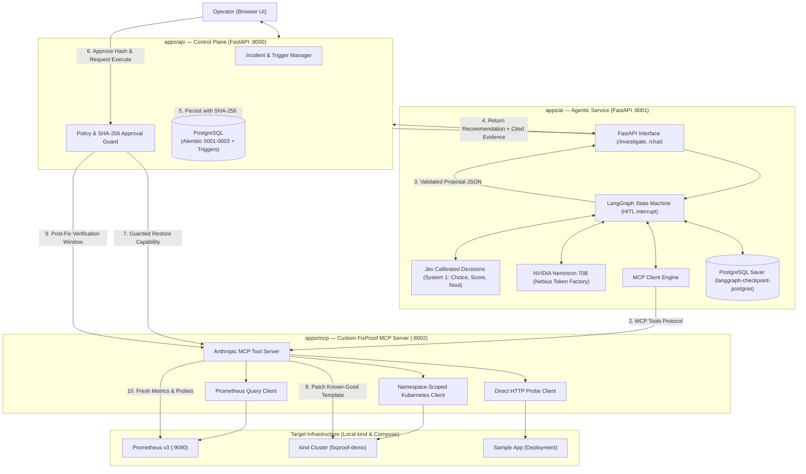

# FixProof — Agentic & Tooling Architecture

> **Directory:** `agentic_architecture/`  
> **Status:** Specification for `apps/ai` and `apps/mcp`  
> **Prerequisites:** `apps/api` (Phase 2 Control Plane) is active with database migrations, SHA-256 approval locking, and audit triggers.  
> **Mission:** Build the bare minimum, production-grade agentic pipeline and custom MCP tool server that integrates seamlessly with the existing `apps/api` lifecycle.

---

## 1. High-Level System Topology

---

## 2. Core Architectural Principles: The "Sweet Spot"

1. **Strict Triad Separation**:
   - **`apps/api` is the Authority:** Owns durable state, database records, operator session authentication, SHA-256 approval verification, and audit event logs.
   - **`apps/ai` is the Investigator:** Stateful LangGraph pipeline utilizing Jev for fast System-1 routing/risk scoring and NVIDIA Nemotron 70B via Nebius for deep System-2 causal explanation.
   - **`apps/mcp` is the Tool Server:** Standardized Model Context Protocol server exposing read-only telemetry tools and one guarded patch tool.
2. **System-1 (Jev) + System-2 (Nemotron 70B)**:
   - Jev evaluates typed questions (`Choice`, `Score`, `Noul`) in milliseconds to route the graph and score blast-radius risk without expensive LLM text generation.
   - Nemotron 70B performs multi-signal causal correlation and writes plain-English hypotheses.
3. **Durable Production Persistence (No Toy SQLite)**:
   - Containerized PostgreSQL with a named host volume (`postgres_data`).
   - LangGraph checkpoints state directly into PostgreSQL using `AsyncPostgresSaver`.
   - The workflow safely pauses for human approval via `interrupt()`, surviving container restarts and long review delays.
4. **AI Never Possesses Direct Write Authority**:
   - The AI agent *cannot* execute bash scripts, *cannot* write raw YAML, and *cannot* access Kubernetes credentials directly.
   - It only recommends an allowlisted action (`restore_known_good_template`).
5. **Evidence Citations Are Mandatory**:
   - Every hypothesis emitted by Nemotron must reference stored `EVD-...` evidence IDs gathered by the MCP server. Unsubstantiated claims are rejected by validation guards.
6. **FastAPI Everywhere for Consistency**:
   - Both `apps/ai` and `apps/mcp` expose clean HTTP/REST and SSE transports using FastAPI and the Python MCP SDK, mirroring the clean Python style of `apps/api`.

---

## 3. Sub-System Specifications

Detailed architecture blueprints are documented in this folder:

1. [MCP_ARCHITECTURE.md](file:///d:/WEB%20DEV%20udemy/FULLSTACK_PROJECTS/nvidia-x-nebius/Nvidia/agentic_architecture/MCP_ARCHITECTURE.md)
   - Custom FixProof MCP server specification.
   - Tool definitions (`query_metrics`, `get_deployment_status`, `get_pod_events`, `get_pod_logs`, `check_service_health`, `restore_known_good_template`).
   - Resource endpoints and namespace-scoped RBAC configuration.
   - Synchronizing tool outputs with `apps/api/app/schemas/lifecycle.py` and `apps/api/app/services/operations.py`.

2. [AI_AGENT_ARCHITECTURE.md](file:///d:/WEB%20DEV%20udemy/FULLSTACK_PROJECTS/nvidia-x-nebius/Nvidia/agentic_architecture/AI_AGENT_ARCHITECTURE.md)
   - LangGraph state machine with Human-in-the-Loop (`interrupt()`).
   - Durable PostgreSQL checkpointing (`AsyncPostgresSaver`).
   - Jev integration (`Choice`, `Score`, `Noul`) for routing and risk scoring.
   - Nebius Token Factory connection (`nvidia/llama-3.1-nemotron-70b-instruct`).
   - LangChain tool calling and interactive operator ChatOps (`/chat`).
   - Pydantic v2 citation validation guards and JSON proposal formatting.
