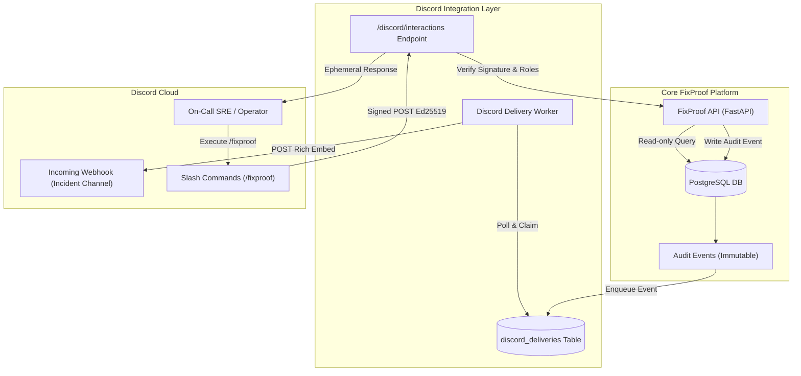

# FixProof Discord Operations Layer

The Discord Operations Layer provides real-time infrastructure event broadcasts and authenticated read-only slash command interactions directly within team communication channels.

> [!IMPORTANT]
> **Strict Authority Boundary**: The FixProof API remains the sole authority for cluster state mutations, remediation proposals, operator approvals, and execution. Discord commands are strictly read-only and **cannot approve proposals, trigger executions, or alter cluster state**. All sensitive operations require an authenticated operator session in the FixProof Web Console.

---

## Architecture Overview

---

## Core Capabilities

1. **Transactional Event Broadcasting**:
   - Committed incident lifecycle events automatically queue delivery to Discord channels.
   - Rich embed cards display severity, status, affected workloads, collected evidence sources, and independent verification verdicts.
   - Dedicated delivery worker decouples Discord availability from core API transactions.

2. **Read-Only Slash Commands**:
   - `/fixproof recent`: Inspect five most recent incidents and their active lifecycle states.
   - `/fixproof incident id:<UUID>`: Inspect detailed status of an incident, including latest investigation and verification verdict.
   - `/fixproof evidence id:<UUID>`: View the canonical evidence items and source categories collected for an incident.

3. **Cryptographic Security & RBAC**:
   - All inbound interaction requests are verified using **Ed25519** public key signatures.
   - Guild-scoped commands restrict access to authorized Discord servers (`DISCORD_GUILD_ID`).
   - Role-based access control enforces `DISCORD_ALLOWED_ROLE_IDS`, ensuring only authorized SREs can inspect cluster status.

---

## Documentation Index

- [Setup & Configuration Guide](SETUP_AND_CONFIGURATION.md): Environment variables, bot setup, webhook creation, and command registration.
- [Webhooks & Alert Pipeline](WEBHOOKS_AND_ALERTS.md): Delivery queue, retry semantics, rich embed styling, and data redaction policies.
- [Slash Commands Reference](SLASH_COMMANDS.md): Command schemas, Ed25519 verification, role authorization, and response formats.
