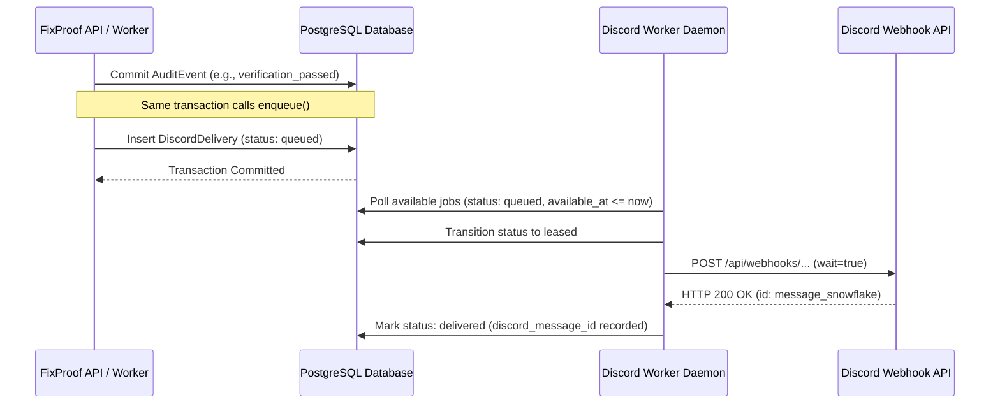

# Discord Webhooks & Channel Alerts

FixProof delivers real-time notifications to dedicated Discord incident channels using official incoming webhooks.

---

## 1. Event Enqueueing Pipeline

Notifications are triggered only when high-integrity **Audit Events** are committed to the PostgreSQL database within an atomic transaction.

### Supported Lifecycle Events & Colors

Every event is styled with a distinct color bar for fast visual parsing by on-call engineers:

| Action / Event | Color Code | Hex Code | Description |
|---|---|---|---|
| `reported` | Blue | `#3498DB` | Incident created by automated monitor or operator report |
| `report_added` | Blue | `#3498DB` | Additional symptoms or triggers attached to active incident |
| `investigation_finished` | Dark Teal | `#16A085` | MCP evidence collection and Nemotron analysis completed |
| `proposed` | Yellow | `#F1C40F` | Baseline restore proposal generated and awaiting human review |
| `approved` | Green | `#2ECC71` | Operator approved proposed configuration restore |
| `rejected` | Red | `#E74C3C` | Operator rejected remediation proposal |
| `execution_succeeded` | Green | `#2ECC71` | Patch applied to Kubernetes deployment (recovery still unverified) |
| `execution_failed` | Red | `#E74C3C` | Patch rejected or failed preflight safety check |
| `execution_outcome_unknown` | Orange | `#E67E22` | Network interruption during patch; reconciliation required |
| `execution_reconciled` | Dark Teal | `#16A085` | Outcome confirmed via cluster read |
| `verification_passed` | Green | `#2ECC71` | **Recovery Verified**: Fresh HTTP 200 probes & low 5xx error rate |
| `verification_failed` | Red | `#E74C3C` | Health check probes failing or high 5xx error rate remains |
| `verification_inconclusive` | Orange | `#E67E22` | Insufficient traffic or missing telemetry in observation window |

---

## 2. Redaction & Safe Data Delivery

FixProof enforces strict data boundary controls before any message payload is delivered to Discord:

- **No Raw Logs or Secrets**: Container stdout/stderr, credentials, cluster certificates, and environment values are never included in webhook payloads.
- **Structured Metrics Only**: Only attested counts (e.g. 5xx request counts, ready replica counts, restart counts, HTTP status codes) and canonical evidence UUIDs are displayed.
- **Disabled Mentions**: All deliveries explicitly include `"allowed_mentions": {"parse": []}` to prevent unintended `@everyone` or `@here` notifications.
- **Audit Correlation**: Every embed footer includes the `audit_event_id` and incident UUID, allowing operators to cross-reference entries in the immutable FixProof Web Console audit log.

---

## 3. Worker Daemon & Retry Guarantees

The delivery worker runs as an independent background daemon (`apps/api/app/discord_worker.py`):

1. **Transactional Leases**: Jobs are claimed using atomic row-level locking (`FOR UPDATE SKIP LOCKED`) so multiple worker instances do not duplicate deliveries.
2. **Rate Limit Handling (HTTP 429)**:
   - When Discord signals rate limiting, the worker inspects the `Retry-After` header and schedules the job for retry with exponential backoff.
3. **Dead-Letter Failure**:
   - If a delivery encounters permanent client errors (HTTP 400, 401, 404) or fails 5 consecutive attempts, the job is marked `failed` and will not block the remaining queue.
4. **Zero State Mutation**:
   - A Discord delivery failure or delay **never affects the underlying incident status, proposal review, or remediation execution**.
